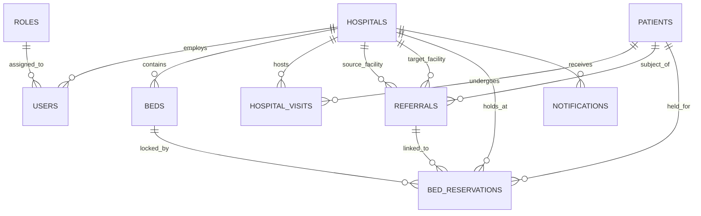
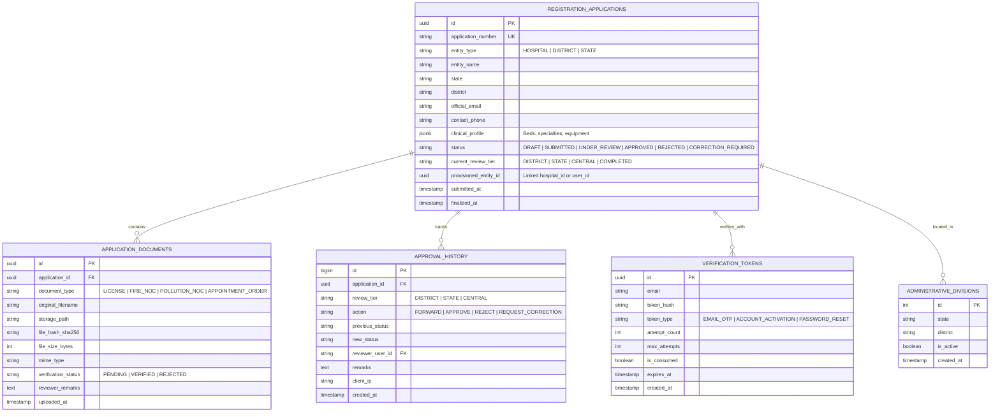

# HIERARCHICAL REGISTRATION, VERIFICATION & APPROVAL SYSTEM
## PHASE 0: EXISTING ARCHITECTURE AUDIT & EXTENSION BLUEPRINT

**Project Name:** SIH Hospital AI  
**Project Location:** `/Users/pawankumarsharma/Desktop/SIH_Hospital_AI`  
**Audit Date:** November 3, 2026  
**Auditor Roles:** Senior Software Architect, Security Engineer, Database Architect, Full-Stack Auditor  
**Audit Scope:** Read-Only Technical Architecture Audit (Zero Code/Data Modifications)

---

## 1. Executive Summary

This architecture audit evaluates the readiness of the **SIH Hospital AI** platform to be extended with a production-grade, **4-Tier Hierarchical Government Registration, Verification, and Approval System**:
1. **Central Government (MoHFW)** — Root Super Admin authority.
2. **State Health Department** — Self-registers; reviewed and approved by Central Government.
3. **District Health Administration (CMO)** — Self-registers; reviewed and approved by State Government, then confirmed by Central Government.
4. **Individual Hospitals (Govt & Private)** — Self-register; reviewed and inspected by District Administration, endorsed by State Government, and finalized by Central Government.

### Core Audit Verdict
The current application provides a robust, verified operational foundation for hospital referral management, bed inventory tracking, and clinical decision support. However, **identity management and institutional onboarding are currently static and decoupled**:
- **Authentication Bypass:** The backend authenticates users against a flat JSON file (`data/runtime/users.json` containing 8 pre-seeded test accounts) rather than the PostgreSQL `users` table.
- **Zero Registration Infrastructure:** There are no endpoints, database entities, or frontend forms for public registration, institutional onboarding, document verification, or approval progression.
- **Zero Self-Service Security:** Password reset, email/SMS OTP verification, and logged-in password changes are not implemented.
- **SQLite / PostgreSQL Split:** Several admin and authorization helper functions (`src/auth/authorization.py`, `src/api/admin_routes.py`, `src/database/patient_service.py`) still import legacy SQLite models (`src/database/database.py`), creating silent data divergence when PostgreSQL is active.

### Key Finding on Grandfathering Existing Hospitals
The existing database contains **100 operational hospitals** (`GH00001` through `GH00100`) tightly coupled to active referrals, patient visits, and bed reservations. To prevent catastrophic regression of existing referral workflows, these hospitals must be automatically **grandfathered** into an active, approved status upon migration, while new applicant facilities must pass through the full 4-tier approval pipeline.

---

## 2. Existing Authentication Audit

### 2.1 User Model & Database Tables
- **PostgreSQL Model (`src/database/pg_models.py::User`, lines 106–125):**
  Defines `user_id` (PK), `username` (unique), `password_hash`, `name`, `role_id` (FK to `roles.id`), `hospital_id` (FK to `hospitals.hospital_id`), `state`, `district`, `is_active` (boolean, default=True), `created_at`, `updated_at`.
- **Runtime JSON Store (`src/auth/auth_store.py::seed_default_users`, lines 99–204):**
  Loads and saves 8 hardcoded accounts into `data/runtime/users.json`.
- **Critical Architectural Gap:**
  The `authenticate_user` function in `src/auth/auth_store.py` (lines 214–235) queries `data/runtime/users.json` directly. The PostgreSQL `users` table is never queried during `/login`. Any user created in PostgreSQL cannot log in under the current implementation.
- **Missing Fields on User Model:**
  The `users` table lacks: `email`, `phone_number`, `designation`, `is_verified`, `activated_at`, `suspended_at`, and `last_login_at`.

### 2.2 Password Hashing & Timing Defense
- **Implementation (`src/auth/auth_store.py::hash_password`, lines 20–33):**
  Uses **PBKDF2-HMAC-SHA256** with **100,000 iterations** and a 16-byte cryptographic salt (`secrets.token_hex(16)`).
- **Timing Attack Defense (`src/auth/auth_store.py::authenticate_user`, lines 232–234):**
  If a submitted username is not found, a dummy PBKDF2 calculation is executed against `DUMMY_PBKDF2_HASH` before returning `None`. This eliminates timing-based username enumeration.
- **Evaluation:** The hashing algorithm and timing defense are production-grade and must be preserved when migrating the user store to PostgreSQL.

### 2.3 JWT & Session Management
- **Implementation (`src/auth/jwt_utils.py`, lines 53–105):**
  Signs tokens using **HS256** with a 60-minute expiration (`ACCESS_TOKEN_EXPIRE_MINUTES = 60`).
  Payload contains: `sub`, `user_id`, `username`, `role`, `hospital_id`, `state`, `district`, `iat`, `exp`.
- **Secret Key Enforcement (`src/auth/jwt_utils.py::get_jwt_secret`, lines 21–46):**
  In `production` or `staging`, `SIH_JWT_SECRET` must be set with at least 32 characters. In development mode, it falls back to `INSECURE_DEV_SECRET = "sih-hospital-ai-demo-secret-change-later"`.
- **Token Revocation (`src/auth/rate_limiter.py::revoke_token`, lines 85–95):**
  Upon `POST /logout`, the token signature is stored in Redis with a TTL matching remaining token lifetime. `require_current_user` rejects revoked tokens with `HTTP 401`.

### 2.4 Login, Activation & Password Recovery
- **Login Endpoint (`src/api/main.py::login`, lines 429–487):**
  Protected by dual-key Redis rate limiting (IP + username). Checks credentials against `auth_store.py`.
- **Account Activation:** **NOT IMPLEMENTED.** No endpoint, token mechanism, or email delivery exists to activate pending accounts.
- **Forgot Password / Password Recovery:** **NOT IMPLEMENTED.** No forgot-password endpoint, reset token generator, or OTP validation exists.
- **Logged-In Password Change:** **NOT IMPLEMENTED.** Users cannot update their passwords while logged in.

### 2.5 Security Dependencies & Middleware
- **`require_current_user` (`src/auth/dependencies.py`, lines 11–53):**
  FastAPI header dependency verifying `Authorization: Bearer <token>`, validating the JWT signature and checking the Redis token revocation blocklist.

---

## 3. Existing Authorization Audit

### 3.1 Role Identification & Role Hierarchy
The system defines 4 roles in `src/auth/authorization.py` (lines 3–8):
```python
HOSPITAL = "HOSPITAL"
DISTRICT_ADMIN = "DISTRICT_ADMIN"
STATE_ADMIN = "STATE_ADMIN"
CENTRAL_ADMIN = "CENTRAL_ADMIN"
```
Roles are embedded directly in the JWT payload upon login and unpacked by `require_current_user`.

### 3.2 Geographic Boundary Enforcement
Geographic boundaries are enforced by `can_access_hospital` in `src/auth/authorization.py` (lines 53–100):
- `CENTRAL_ADMIN`: Unrestricted national access.
- `STATE_ADMIN`: Restricted to hospitals matching `user.state`.
- `DISTRICT_ADMIN`: Restricted to hospitals matching `user.state` AND `user.district`.
- `HOSPITAL`: Restricted strictly to `user.hospital_id`.

### 3.3 Identified Authorization Flaws & Vulnerabilities

| # | Flaw / Vulnerability | File & Location | Technical Details | Risk Level |
|---|---|---|---|---|
| **V1** | **Legacy SQLite Lookup in Authorization Dependency** | `src/auth/authorization.py::get_hospital_geo` (lines 24–49) | `get_hospital_geo` queries SQLite `src.database.database.SessionLocal`! If SQLite is desynchronized from PostgreSQL, `get_hospital_geo` returns `None`, causing `can_access_hospital` to deny legitimate State and District Admins. | **High** |
| **V2** | **Hardcoded Geographic Fallbacks in Admin Router** | `src/api/admin_routes.py::resolve_district_scope` (lines 65, 69–71) | When a State or Central admin does not specify query parameters, the backend hardcodes `target_district = "Amritsar"` and `target_state = "Punjab"`. A State Admin for Maharashtra defaulting to Amritsar receives conflicting records. | **Medium** |
| **V3** | **Unauthenticated Public Hospital Listings** | `src/api/patient_routes.py::get_hospitals` (lines 31–49) | `/patients/hospitals` and `/patients/hospitals/{hospital_id}` do not require authentication (`require_current_user`), exposing institutional metadata to unauthenticated public scraping. | **Low** |
| **V4** | **Unprotected Referral Status Updates from Inactive Users** | `src/auth/authorization.py::can_update_referral_status` | Does not verify whether `user.get("is_active")` is True. If an account is deactivated in PostgreSQL, valid unexpired JWTs can continue mutating referral states. | **High** |

---

## 4. Existing Database Architecture

### 4.1 PostgreSQL Schema Status
Managed in PostgreSQL 17.11 (`sih_hospital_dev`) across **10 relational tables**:



### 4.2 Schema Entities & Relational Foreign Keys
1. `roles` (`id`, `description`, `created_at`)
2. `hospitals` (`hospital_id` PK, `name`, `state`, `district`, `city`, `latitude`, `longitude`, beds, equipment)
3. `users` (`user_id` PK, `username` UK, `password_hash`, `name`, `role_id` FK, `hospital_id` FK, `state`, `district`, `is_active`)
4. `patients` (`patient_id` PK, `abha_id`, `name`, `age`, `gender`, `disease`, `priority`, vitals)
5. `hospital_visits` (`id` PK, `patient_id` FK, `hospital_id` FK, `status`, `notes`)
6. `beds` (`id` PK, `hospital_id` FK, `bed_number`, `bed_type`, `status`)
7. `referrals` (`referral_id` PK, `patient_id` FK, `from_hospital_id` FK, `to_hospital_id` FK, `status`, `ambulance_id`, `eta_minutes`)
8. `bed_reservations` (`reservation_id` PK, `referral_id` FK, `hospital_id` FK, `bed_id` FK, `status`, `expires_at`)
9. `notifications` (`id` PK, `hospital_id` FK, `referral_id` FK, `event_type`, `title`, `message`, `is_read`)
10. `audit_logs` (`id` PK, `entity_type`, `entity_id`, `action`, `performed_by`, `previous_state`, `new_state`)

### 4.3 Database Gaps Relative to Hierarchical Registration
1. **No Application Entities:** There are no tables for registration applications, uploaded verification documents, or multi-tier approval histories.
2. **No States or Districts Master Tables:** `state` and `district` are currently unindexed strings across `hospitals` and `users`. No normalized lookup tables exist for validating official administrative boundaries.
3. **No Hospital Approval Tracking:** `hospitals` table has no columns for `approval_status`, `registration_number`, `license_expiry`, or `approved_at`.

---

## 5. Existing Frontend Architecture

### 5.1 Next.js Application Layout
- **Root Shell (`frontend/app/layout.tsx`):** Sets up HTML, Inter font, metadata, and Tailwind CSS imports.
- **Root Router (`frontend/app/page.tsx`):**
  - If user is not authenticated: Displays the login screen with demo credential cards.
  - If authenticated: Dynamically mounts the appropriate role dashboard based on `user.role`:
    - `CENTRAL_ADMIN` $\rightarrow$ `<CentralDashboard />`
    - `STATE_ADMIN` $\rightarrow$ `<StateDashboard />`
    - `DISTRICT_ADMIN` $\rightarrow$ `<DistrictDashboard />`
    - `HOSPITAL` $\rightarrow$ `<HospitalDashboard />`

### 5.2 Frontend Components & Reusability
- **Shared Components (`frontend/components/shared/`):**
  - `Header.tsx`: Displays role badge, jurisdiction, clock, and logout button.
  - `Modal.tsx`: Accessible dialog box with ESC listener and backdrop blur.
  - `StatusBadge.tsx`: Color-coded pill component.
  - `Toast.tsx`: Notification banner with auto-dismiss.
  - `LoadingAndErrorStates.tsx` & `EmptyState.tsx`: Standardized states.
- **Missing Form Components:** The frontend lacks multi-step form wizards, file upload dropzones, document previewers, and OTP input pin-grids.

### 5.3 Recommended Placement for Registration & Tracking UI
To maintain clean Next.js App Router routing without colliding with the authenticated dashboard (`/`):
- `/register` — Registration portal with entity selector (Hospital / District / State).
- `/register/hospital` — Multi-step hospital onboarding wizard (Facility info, beds, documents).
- `/register/district` — District administrative registration form.
- `/register/state` — State administrative registration form.
- `/track` — Public application tracking page.
- `/activate` — Secure password creation and account activation page.
- `/forgot-password` — Email OTP password recovery wizard.

---

## 6. Existing Hospital Data & Migration Strategy

### 6.1 Current Hospital Data
- **Catalog Dataset:** `datasets/final/hospitals.csv` contains 100 benchmark hospitals across India.
- **Identifier Pattern:** Sequential alphanumeric codes: `GH00001` to `GH00100`.
- **Database Status:** Loaded into PostgreSQL `hospitals` table with pre-configured bed counts, geographical coordinates, and clinical capabilities.

### 6.2 Zero-Disruption Grandfathering Strategy
Because existing hospitals have active foreign key linkages to referrals and bed records, they cannot be placed into a `PENDING` state:
1. **Schema Evolution:** Add an `approval_status` column to `hospitals` (`VARCHAR(30)` default `'APPROVED'`).
2. **Grandfathering Seed:** All existing 100 hospitals are marked `is_grandfathered = True` and `approval_status = 'APPROVED'`.
3. **Application Gating:** New self-registering hospitals are stored in a dedicated `registration_applications` table. They are only copied into the operational `hospitals` table **after receiving final Central approval**.
4. **Referral Engine Protection:** Recommendation and referral queries (`/hospitals`, `/referrals`) will filter for `approval_status == 'APPROVED'`, ensuring unapproved applicant facilities never receive patient referrals.

---

## 7. Proposed New Architecture: Recommended Entities

To support hierarchical registration without mutating existing operational schemas, **6 new normalized tables** must be introduced:



---

## 8. Multi-Tier Approval Workflow Analysis

The new approval system strictly enforces the government administrative hierarchy:

```mermaid
flowchart TD
    subgraph HospitalFlow ["Hospital Registration Approval Chain"]
        H_SUB["Hospital Submits Application\n(Status: SUBMITTED)"] --> H_DIST["Tier 1: District Review (CMO)\nVerify facility, beds, documents"]
        H_DIST -->|Approved| H_STATE["Tier 2: State Review\nVerify regional distribution"]
        H_DIST -->|Rejected / Correction| H_SUB
        H_STATE -->|Approved| H_CENTRAL["Tier 3: Central Review (MoHFW)\nFinal national sanction"]
        H_STATE -->|Rejected / Correction| H_DIST
        H_CENTRAL -->|Approved| H_ACTIVE["FINAL APPROVAL:\n1. Insert into hospitals table\n2. Create inactive User account\n3. Send Activation Email with Token"]
        H_CENTRAL -->|Rejected / Correction| H_STATE
    end

    subgraph DistrictFlow ["District Administration Approval Chain"]
        D_SUB["District Office Submits Application"] --> D_STATE["Tier 1: State Review\nVerify official CMO appointment"]
        D_STATE -->|Approved| D_CENTRAL["Tier 2: Central Review\nVerify administrative boundaries"]
        D_STATE -->|Rejected / Correction| D_SUB
        D_CENTRAL -->|Approved| D_ACTIVE["FINAL APPROVAL:\n1. Create DISTRICT_ADMIN account\n2. Send Activation Email with Token"]
        D_CENTRAL -->|Rejected / Correction| D_STATE
    end

    subgraph StateFlow ["State Health Department Approval Chain"]
        S_SUB["State Department Submits Application"] --> S_CENTRAL["Tier 1: Central Review (MoHFW)\nVerify State Secretariat Order"]
        S_CENTRAL -->|Approved| S_ACTIVE["FINAL APPROVAL:\n1. Create STATE_ADMIN account\n2. Send Activation Email with Token"]
        S_CENTRAL -->|Rejected / Correction| S_SUB
    end
```



### State Machine Transition Rules
- **Correction Required:** When an authority requests corrections, the status transitions to `CORRECTION_REQUIRED`. The applicant can edit fields and re-upload documents. Upon re-submission (`POST /applications/{id}/resubmit`), the application resumes review at the tier that requested the correction.
- **Audit Logging:** Every transition automatically writes an immutable record to `approval_history` storing `reviewer_user_id`, `action`, `remarks`, `ip_address`, and `created_at`.

---

## 9. Security Requirements & Privacy Guardrails

1. **Document Storage Security:**
   - Uploaded documents must **never** be saved in a public web root.
   - Files are stored in `data/uploads/applications/<application_id>/` with randomized UUID filenames.
   - Enforce strict server-side validation: PDF, PNG, JPEG only; maximum file size 5 MB. Compute and store SHA-256 file hashes to detect tampering.
2. **Private Document Access:**
   - Access to documents is served exclusively via an authenticated streaming endpoint: `GET /applications/{app_id}/documents/{doc_id}/download`.
   - Access is restricted to the applicant and reviewers within authorized geographic jurisdiction.
3. **Public Tracking Privacy (PII Scrubbing):**
   - The public tracking endpoint (`GET /applications/track/{application_number}`) must **never** expose:
     - Aadhaar numbers, personal phone numbers, or doctor email addresses.
     - Internal audit remarks or reviewer IDs.
     - Document storage paths or download links.
   - Only public metadata is exposed: `application_number`, `entity_name`, `entity_type`, `state`, `district`, `status`, `current_review_tier`, and `submission_date`.
4. **Email OTP & Activation Security:**
   - OTPs are cryptographically secure 6-digit codes (`secrets.randbelow`).
   - OTPs are hashed before database insertion; plain OTPs are never stored.
   - Max 3 verification attempts per token; 10-minute expiration TTL.
   - Rate limiting: max 3 OTP generation requests per email per hour.
5. **Session Revocation on Password Reset:**
   - When a password is reset, a `user_epoch` is updated in Redis, immediately invalidating all active JWT tokens issued prior to that timestamp.

---

## 10. Existing Functionality Protection & Regression Matrix

To prevent breaking existing referral, bed reservation, and AI recommendation features, the following regression test matrix must be maintained:

| Operational Subsystem | Potential Impact Point | Regression Prevention Measure | Test Suite Validation |
|---|---|---|---|
| **AI Recommendation** | Candidate hospital catalog filtering | Recommendations query must explicitly filter `approval_status == 'APPROVED'`, ignoring pending applicant facilities. | `tests/test_ai_recommendation_evaluation.py` |
| **Bed Reservation** | Hospital bed locking & inventory | Reservations must only lock beds belonging to approved hospitals; applicant facilities have no active bed inventory. | `tests/test_referral_and_bed_lifecycle.py` |
| **Referral Lifecycle** | Inter-hospital patient transfer | Unapproved hospitals cannot be selected as source or destination targets in `POST /referrals`. | `tests/test_end_to_end_referral_workflow.py` |
| **Existing Dashboards** | Hospital, District, State, Central views | Existing operational dashboards remain untouched; registration review queues are added as distinct tabs. | `tests/test_admin_hierarchy.py` |
| **Authentication** | Demo user logins (`gh00046`, `punjab_admin`) | Unifying `auth_store.py` with PostgreSQL must seed existing demo users into `users` table so existing logins continue functioning. | `tests/test_auth_and_access.py` |

---

## 11. Complete Audit Findings Table

The table below catalogs all specific architectural limitations identified during this audit:

| Finding ID | Area | File Path & Function | Existing Implementation | Problem / Architectural Limitation | Recommended Modification | Risk Level |
|---|---|---|---|---|---|---|
| **F-01** | Authentication | `src/auth/auth_store.py::authenticate_user` (lines 214–235) | Reads and authenticates from `data/runtime/users.json`. | PostgreSQL `users` table is bypassed. Any registered or approved user in PostgreSQL cannot log in. | Refactor `authenticate_user` to query PostgreSQL `users` table via `db_manager`. | **Critical** |
| **F-02** | Registration | `src/api/` (all modules) | Zero registration endpoints exist in FastAPI. | No self-service registration or institutional onboarding can occur. | Create `src/api/registration_routes.py` with multi-tier submission endpoints. | **Critical** |
| **F-03** | Approval Workflow | `src/api/admin_routes.py` | Admin endpoints serve read-only analytics. | No approval/rejection endpoints or review queues exist for District, State, or Central Admins. | Add `POST /admin/applications/{id}/approve` and `/reject` with geographic RBAC. | **High** |
| **F-04** | Document Security | None | No file upload infrastructure exists. | Medical licenses and government orders cannot be collected or validated. | Implement multipart upload with MIME sniffing, SHA-256 hashing, and private download streams. | **High** |
| **F-05** | Credential Lifecycle | `src/auth/` (all modules) | No activation, forgot password, or password change logic. | Users cannot activate approved accounts or recover forgotten credentials. | Build `src/auth/otp_service.py` with Brevo email OTP delivery and Redis token revocation. | **High** |
| **F-06** | Authorization | `src/auth/authorization.py::get_hospital_geo` (lines 24–49) | Imports SQLite `src.database.database.SessionLocal`. | Fails to look up hospital jurisdiction when running on PostgreSQL, causing false 403 Forbidden errors. | Refactor `get_hospital_geo` to query PostgreSQL `Hospital` model via `db_manager`. | **High** |
| **F-07** | Database Schema | `src/database/pg_models.py` | Only operational models exist (10 tables). | No schema support for applications, documents, approval history, or OTP tokens. | Create `migrations/003_registration_system.sql` and declare models in `pg_models.py`. | **High** |
| **F-08** | Authorization Scope | `src/api/admin_routes.py::resolve_district_scope` (lines 65, 69) | Hardcodes fallback to `"Amritsar"` and `"Punjab"`. | State/Central admins querying other states get incorrect default filters. | Require explicit `state` and `district` parameters without hardcoded geographic fallbacks. | **Medium** |
| **F-09** | Frontend Routing | `frontend/app/page.tsx` | All views mounted inside single root page conditionally. | No dedicated URLs for public registration, application tracking, or account activation. | Create dedicated Next.js route groups: `/register`, `/track`, `/activate`, `/forgot-password`. | **Medium** |
| **F-10** | Hospital Isolation | `src/prediction/ranking_engine.py` | Ranks all hospitals present in database. | Unapproved applicant hospitals could theoretically be recommended for emergency transfers. | Filter candidate query by `approval_status == 'APPROVED'` and `is_active == True`. | **High** |

---

## 12. Recommended Target Architecture & Implementation Plan

### 12.1 Target Architecture Blueprint

```
+----------------------------------------------------------------------------------------------------+
|                                    TARGET PLATFORM ARCHITECTURE                                    |
+--------------------------+-----------------------+------------------------+------------------------+
| Public Portal Layer      | Operational Dashboards| Backend API Services   | Infrastructure Layer   |
+--------------------------+-----------------------+------------------------+------------------------+
| * /register/hospital     | * Hospital Dashboard  | * Registration API     | * PostgreSQL 17        |
| * /register/district     | * District Dashboard  | * Approval Workflow API|   (16 relational tables|
| * /register/state        | * State Dashboard     | * Document Upload API  |    ACID transactions)  |
| * /track (Public PII-Safe| * Central Dashboard   | * Email OTP Service    | * Redis 8 Cache        |
| * /activate (Password Set| (with Approval Queues)| * Auth & RBAC Services | * Brevo Email API      |
| * /forgot-password       |                       | * Core Referral Engine | * Secure File Storage  |
+--------------------------+-----------------------+------------------------+------------------------+
```

### 12.2 Required Database Changes
Apply `migrations/003_registration_system.sql` introducing:
- `registration_applications` (UUID PK, application number, entity type, profile JSONB, status).
- `application_documents` (UUID PK, application FK, storage path, SHA-256 hash, MIME type).
- `approval_history` (BigInt PK, application FK, review tier, action, reviewer FK, remarks).
- `verification_tokens` (UUID PK, email, hashed token, token type, expiry timestamp).
- Add `approval_status` (`VARCHAR(30)` default `'APPROVED'`) and `is_grandfathered` (`BOOLEAN` default `TRUE`) to `hospitals`.
- Add `email`, `phone_number`, `designation` to `users`.

### 12.3 Required Backend Changes
1. **Unify Authentication (`src/auth/auth_store.py`):**
   Redirect `authenticate_user` to query PostgreSQL `users` table with PBKDF2 hash verification.
2. **Registration Router (`src/api/registration_routes.py`):**
   Endpoints for application submission, document upload, and public status tracking.
3. **Approval Router (`src/api/approval_routes.py`):**
   Endpoints for District, State, and Central reviewers with geographic RBAC enforcement.
4. **Email OTP Service (`src/services/email_service.py` & `src/auth/otp_service.py`):**
   Brevo API client with console fallback for local testing; token generation and validation.
5. **Fix Authorization SQLite Imports (`src/auth/authorization.py`):**
   Eliminate SQLite imports in `get_hospital_geo` and point directly to PostgreSQL.

### 12.4 Required Frontend Changes
1. **Public Routes:**
   - `frontend/app/register/page.tsx` — Multi-step registration portal.
   - `frontend/app/track/page.tsx` — Public application tracking interface.
   - `frontend/app/activate/page.tsx` — First-time account password setup.
   - `frontend/app/forgot-password/page.tsx` — Password reset with OTP input.
2. **Administrative Dashboards:**
   - Add "Pending Registrations" review tab to `DistrictDashboard.tsx`, `StateDashboard.tsx`, and `CentralDashboard.tsx`.
   - Embed document preview modal and approval/rejection action dialogs with remark inputs.

### 12.5 Dependency-Ordered Implementation Plan

```
+----------------------------------------------------------------------------------------------------+
|                                 PHASED IMPLEMENTATION ROADMAP                                      |
+----------------------------------------------------------------------------------------------------+
| Phase 1: Authentication Unification & Database Schema Expansion                                    |
| - Apply migrations/003_registration_system.sql (new tables + hospital columns).                    |
| - Declare SQLAlchemy models in src/database/pg_models.py.                                          |
| - Migrate auth_store.py to query PostgreSQL users; seed default demo accounts into PostgreSQL.     |
| - Fix SQLite dependencies in authorization.py (get_hospital_geo).                                  |
| - Deliverable: Unified PostgreSQL authentication with 0 regression on existing tests.              |
+----------------------------------------------------------------------------------------------------+
| Phase 2: Email OTP Engine & Credential Self-Service                                                |
| - Implement src/services/email_service.py (Brevo API client + console terminal fallback).          |
| - Implement src/auth/otp_service.py (6-digit OTP, verification_tokens table, attempt limiter).     |
| - Build POST /auth/forgot-password and POST /auth/reset-password endpoints.                        |
| - Build POST /auth/change-password (logged-in) with Redis session invalidation.                    |
| - Deliverable: Verified email OTP and password recovery lifecycle.                                 |
+----------------------------------------------------------------------------------------------------+
| Phase 3: Registration Applications & Secure Document Storage Backend                               |
| - Build POST /register/hospital, POST /register/district, POST /register/state endpoints.          |
| - Build secure multipart document upload endpoint with MIME validation and SHA-256 hashing.        |
| - Build private streaming document download endpoint with RBAC checks.                             |
| - Build privacy-scrubbed public tracking endpoint (GET /applications/track/{app_number}).          |
| - Deliverable: Fully tested registration submission and public tracking APIs.                      |
+----------------------------------------------------------------------------------------------------+
| Phase 4: Multi-Tier Hierarchical Approval Workflow Engine                                          |
| - Build approval action endpoints (POST /admin/applications/{id}/approve, /reject, /correct).      |
| - Enforce geographic review boundaries (District CMO -> State Directorate -> Central MoHFW).      |
| - Implement automated entity provisioning upon final Central approval (hospital + inactive user).  |
| - Generate activation token and dispatch account setup email to applicant.                         |
| - Deliverable: Complete multi-tier approval state machine with audit history.                      |
+----------------------------------------------------------------------------------------------------+
| Phase 5: Frontend Registration Portal, Tracking UI & Approval Dashboards                           |
| - Create Next.js pages: /register, /track, /activate, /forgot-password.                             |
| - Add Pending Application Review queues to District, State, and Central dashboards.                |
| - Integrate document viewing modals and approval action dialogs.                                   |
| - Deliverable: Complete end-to-end frontend user experience across all tiers.                      |
+----------------------------------------------------------------------------------------------------+
| Phase 6: End-to-End Regression Verification & Security Validation                                  |
| - Execute full 132-test regression suite ensuring zero breakage in referral/bed systems.           |
| - Author dedicated integration tests covering the complete 4-tier registration lifecycle.          |
| - Conduct security audit on file uploads, PII scrubbing, and brute-force rate limits.              |
| - Deliverable: Final delivery report and validated production-grade system.                        |
+----------------------------------------------------------------------------------------------------+
```

---

## 13. Audit Conclusion

The existing **SIH Hospital AI** architecture is well-structured and provides verified transactional safety for clinical referrals and bed holds. Its current limitations regarding registration, identity, and authorization stem from its prototype origins (flat JSON user storage and decoupled operational catalogs). 

By implementing the **6 additive database entities**, unifying authentication around PostgreSQL, grandfathering the 100 existing operational hospitals, and introducing the **4-tier approval state machine**, the registration extension can be integrated seamlessly with **zero disruption** to existing clinical referral features.
