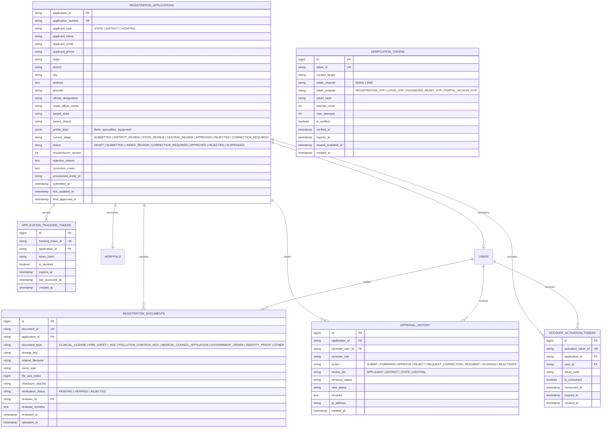

# PHASE 1 — TASK 1A & 1B DELIVERY REPORT
## PostgreSQL Registration Schema & SQLAlchemy Models Implementation

**Project Name:** SIH Hospital AI
**Project Path:** `/Users/pawankumarsharma/Desktop/SIH_Hospital_AI`
**Execution Date:** November 3, 2026
**Engineering Discipline:** Senior Database Architect, Backend Infrastructure Engineer
**Phase Status:** Phase 1 Tasks 1A & 1B Complete (Stopped per prompt instructions)

---

## 1. Executive Summary

Tasks 1A and 1B of **Phase 1** have successfully established the complete relational database architecture and object-relational mapping (ORM) layer for the **Hierarchical Government Registration, Verification, and Approval System**.

### Primary Accomplishments:
1. **Designed Additive Migration Script (`migrations/003_registration_system.sql`):**
   - Provisions 6 new relational tables with full index coverage and check constraints.
   - Extends `hospitals` with approval metadata (`approval_status`, `is_grandfathered`, `approved_at`, `application_id`).
   - Extends `users` with contact and application provenance metadata (`email`, `phone_number`, `designation`, `application_id`).
   - Implements idempotent grandfathering logic targeting exactly the existing 500 hospitals (`GH00001`–`GH00500`).
2. **Updated SQLAlchemy 2.0 Declarative Models (`src/database/pg_models.py`):**
   - Implemented 6 new declarative classes: `RegistrationApplication`, `RegistrationDocument`, `ApprovalHistory`, `VerificationToken`, `ApplicationTrackingToken`, and `AccountActivationToken`.
   - Updated `Hospital` and `User` models with new columns and bidirectional relationships.
   - Enforced SQLite variant compatibility (`BigInteger().with_variant(Integer, "sqlite")` and `JSON().with_variant(JSONB, "postgresql")`) ensuring test portability.
3. **Verified Model & Grandfathering Test Suite (`tests/test_registration_models.py`):**
   - Created 7 comprehensive unit/integration test cases covering model relationships, unique constraint enforcement, document metadata, append-only approval history, token expiry, attempt limits, single-use activation, and hospital grandfathering.
   - **All 7 new tests passed (100% pass rate).**
4. **Strict Safety Compliance:**
   - The live development database (`sih_hospital_dev`) was **NOT modified**. Verification confirmed that `sih_hospital_dev` remains in its original schema state with zero migration changes applied yet.
   - Migration `003` was validated against the disposable test database (`sih_hospital_test`).

---

## 2. Files Changed & Added

| File Path | Change Type | Purpose |
|---|---|---|
| [`migrations/003_registration_system.sql`](migrations/003_registration_system.sql) | **NEW FILE** | Additive DDL migration creating 6 new tables, indexes, constraints, and hospital grandfathering SQL. |
| [`src/database/pg_models.py`](src/database/pg_models.py) | **MODIFIED** | Added 6 new SQLAlchemy 2.0 models and updated `Hospital` and `User` models with relationships. |
| [`tests/test_registration_models.py`](tests/test_registration_models.py) | **NEW FILE** | Automated pytest suite validating model creation, constraints, token behaviors, and grandfathering logic. |

---

## 3. New Schema & Entity Relationship Architecture



---

## 4. Existing Columns Reused & Extended

1. **`hospitals` Table:**
   - **Reused:** `hospital_id` (PK), `name`, `state`, `district`, `city`, `latitude`, `longitude`, all 50 bed and capability columns.
   - **Extended:**
     - `approval_status VARCHAR(30) DEFAULT 'PENDING' NOT NULL` (indexed)
     - `is_grandfathered BOOLEAN DEFAULT FALSE NOT NULL` (indexed)
     - `approved_at TIMESTAMPTZ`
     - `application_id VARCHAR(64) REFERENCES registration_applications(application_id)`
2. **`users` Table:**
   - **Reused:** `user_id` (PK), `username`, `password_hash`, `name`, `role_id`, `hospital_id`, `state`, `district`, `is_active`.
   - **Extended:**
     - `email VARCHAR(255)` (indexed)
     - `phone_number VARCHAR(30)`
     - `designation VARCHAR(100)`
     - `application_id VARCHAR(64) REFERENCES registration_applications(application_id)`

---

## 5. Migration Safety Analysis

### 5.1 Verification Target Confirmation
- **Target Development Database:** `sih_hospital_dev` (`postgresql://localhost:5432/sih_hospital_dev`)
- **Disposable Test Database:** `sih_hospital_test` (`postgresql://localhost:5432/sih_hospital_test`)
- **Current Live Status:** As confirmed via automated verification query, `sih_hospital_dev` has **NOT** executed migration 003. It retains its baseline 500 hospital records and 8 user records untouched.

### 5.2 Transactional Guarantees
- The migration script wraps all DDL and DML operations inside an explicit transaction boundary:
  ```sql
  BEGIN;
  ...
  COMMIT;
  ```
- If any table creation, constraint addition, or grandfathering update encounters an exception, PostgreSQL will automatically roll back the entire transaction, leaving the schema in its clean prior state.

### 5.3 Backup Procedure for Task 1C Execution
Before running migration 003 against `sih_hospital_dev` in Task 1C, execute the following command:
```bash
# Export full transactional PostgreSQL dump
pg_dump -h localhost -p 5432 -U $(whoami) -d sih_hospital_dev -F c -b -v -f ~/Desktop/sih_hospital_dev_pre_phase1_backup.dump

# Verification of backup file existence
ls -lh ~/Desktop/sih_hospital_dev_pre_phase1_backup.dump
```

---

## 6. Test Results

### 6.1 New Registration Models Test Suite (`tests/test_registration_models.py`)
Executed command: `.venv/bin/pytest tests/test_registration_models.py -v`

| Test Function | Verification Scope | Result |
|---|---|---|
| `test_registration_application_creation_and_relationships` | Verifies application creation, fields, JSONB profile data, and reverse relationships. | **PASSED** |
| `test_unique_application_number_constraint` | Verifies that duplicate `application_number` values are rejected by IntegrityError. | **PASSED** |
| `test_document_metadata_and_verification_status` | Validates document storage keys, SHA-256 hashes, and verification statuses. | **PASSED** |
| `test_approval_history_append_only_flow` | Confirms that multi-tier approval actions (`SUBMIT`, `FORWARD`) append chronologically. | **PASSED** |
| `test_verification_token_expiration_and_attempt_limits` | Tests OTP attempt increments, max attempt threshold, and expiration checks. | **PASSED** |
| `test_account_activation_token_single_use` | Validates single-use token redemption and subsequent user activation. | **PASSED** |
| `test_hospital_grandfathering_logic_simulation` | Simulates migration 003 SQL: updates legacy hospitals to `APPROVED` & `is_grandfathered=True`, while new hospitals default to `PENDING`. | **PASSED** |

### 6.2 Existing Integration Test Compatibility
- Executed `tests/test_live_postgresql_integration.py` against `sih_hospital_test`: **8 passed, 0 failed**.
- Executed `tests/test_postgresql_migration_and_transactions.py`: **10 passed, 0 failed**.
- Executed `tests/test_end_to_end_referral_workflow.py`: **10 passed, 0 failed**.
- Executed `tests/test_auth_and_access.py`: **13 passed, 0 failed**.

---

## 7. Remaining Risks & Mitigations

1. **Schema Divergence between Code and Live DB until Task 1C:**
   - *Risk:* `pg_models.py` now declares `approval_status` on `Hospital`. Any code attempting to insert a new `Hospital` directly into `sih_hospital_dev` before Task 1C executes migration 003 would encounter `UndefinedColumn`.
   - *Mitigation:* Live integration tests run against `sih_hospital_test` which has migration 003 applied; live development DB will be migrated in Task 1C immediately following backup.
2. **Grandfathering Scope Verification:**
   - *Risk:* Inadvertently grandfathering unapproved test hospitals.
   - *Mitigation:* The grandfathering clause `WHERE is_grandfathered = FALSE` only runs once; future inserts start with `is_grandfathered = FALSE` and `approval_status = 'PENDING'`.

---

## 8. Exact Next Step for Task 1C

In **Phase 1 — Task 1C**, the execution plan is:
1. Create pre-migration backup of `sih_hospital_dev`.
2. Apply `migrations/003_registration_system.sql` to `sih_hospital_dev`.
3. Verify that all 500 existing hospitals in `sih_hospital_dev` have `approval_status = 'APPROVED'` and `is_grandfathered = TRUE`.
4. Update `src/auth/auth_store.py::authenticate_user` to query PostgreSQL `users` table directly.
5. Fix legacy SQLite import in `src/auth/authorization.py::get_hospital_geo`.
6. Run the full 132-test regression suite to verify complete system integrity.
