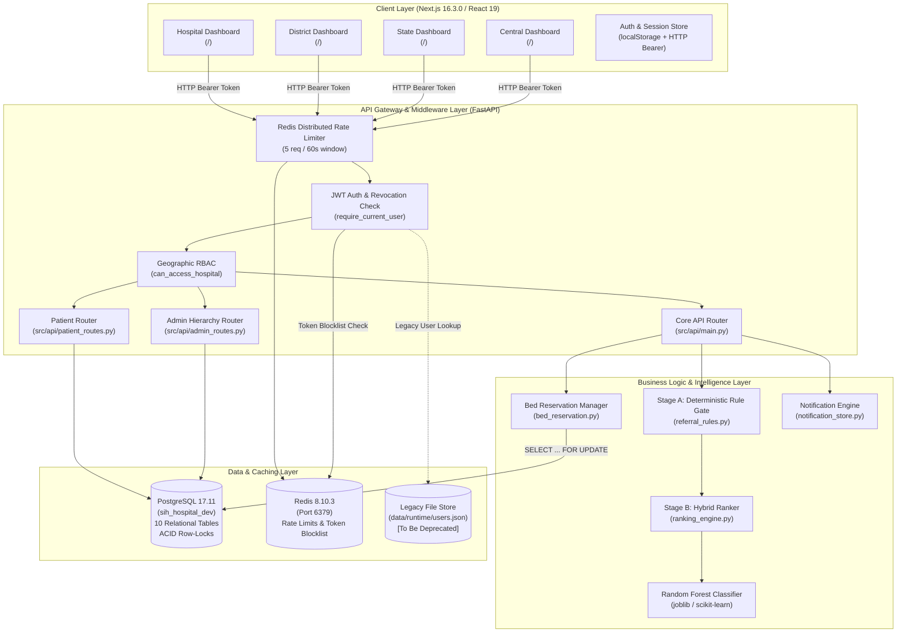
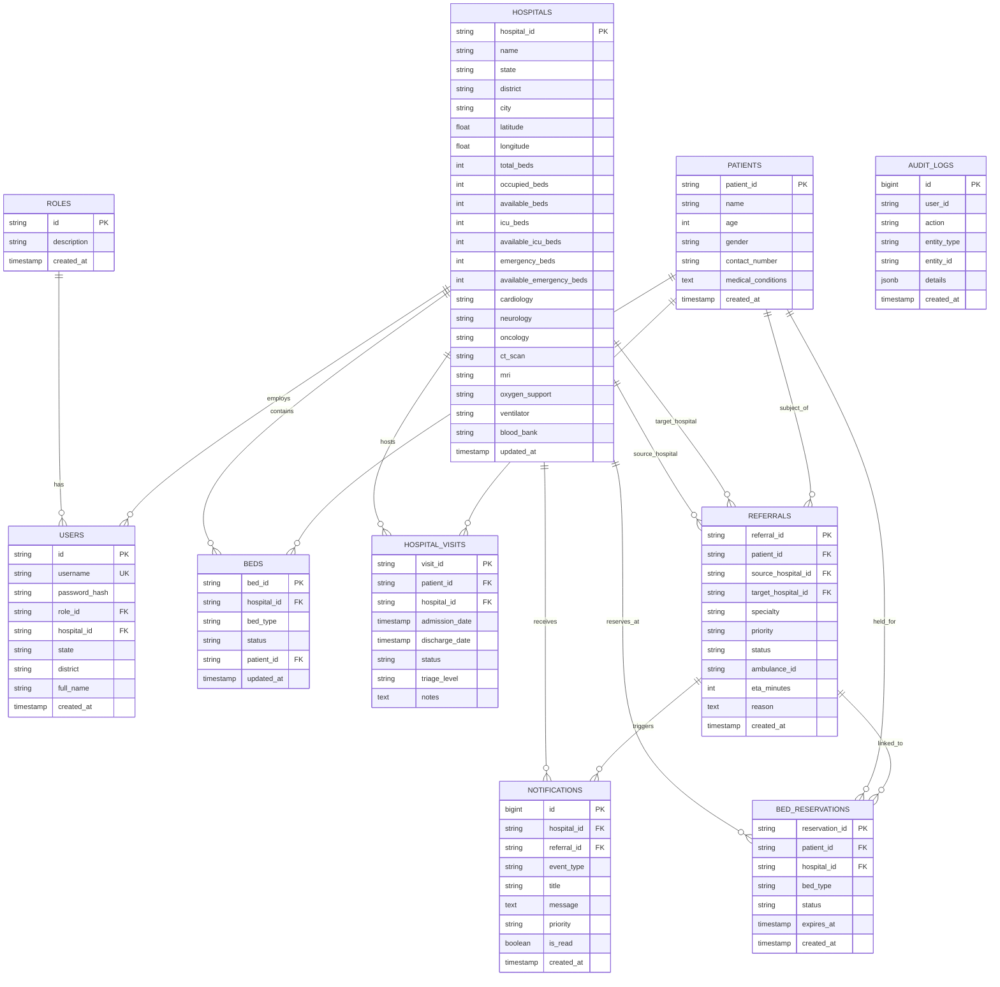
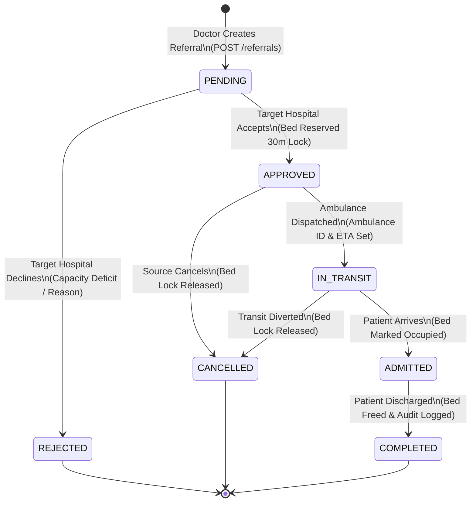
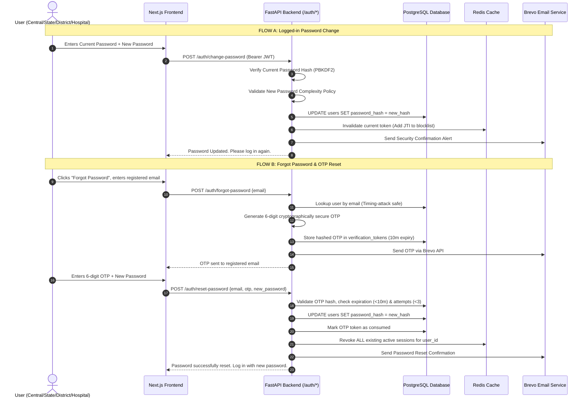

# SIH HOSPITAL AI: MASTER TECHNICAL AUDIT & GOVERNMENT REGISTRATION SYSTEM ARCHITECTURAL ASSESSMENT

**Project Name:** SIH Hospital AI  
**Project Path:** `/Users/pawankumarsharma/Desktop/SIH_Hospital_AI`  
**Audit Date:** November 3, 2026  
**Auditor Roles:** Senior Software Architect, Full-Stack Developer, Database Architect, AI/ML Systems Engineer, Application Security Engineer, Technical Auditor  
**Audit Classification:** Technical Systems Audit & Requirements Feasibility Assessment (Strictly Read-Only / Non-Destructive)

---

## 1. Executive Summary

A comprehensive architectural and security audit of the **SIH Hospital AI** platform was conducted on November 3, 2026. The objective was twofold:
1. Independently evaluate and document the current operational state across the backend, frontend, database, distributed caching, machine learning recommendation engine, and clinical referral workflows without altering any source code or production data.
2. Formulate a technical requirements and architectural gap analysis for integrating a new **4-Tier Hierarchical Government Registration & Approval System** (Central Ministry $\rightarrow$ State Department $\rightarrow$ District Office $\rightarrow$ Individual Hospital) along with secure self-service password management and free-tier Email OTP verification.

### Key Audit Findings

* **Current Architecture Health:**
  * **Backend:** FastAPI application exposing **44 total endpoints** (40 functional API endpoints and 4 OpenAPI/documentation routes). Routes are modularized into core referral operations, patient visits, and multi-tier administrative reporting.
  * **Database:** PostgreSQL 17.11 (`sih_hospital_dev`) with **10 normalized relational tables** managed through SQLAlchemy 2.0 ORM and transactional SQL migrations. ACID transactions protect bed allocations and status transitions with explicit row-level locking (`SELECT FOR UPDATE`).
  * **Distributed Cache & Rate Limiting:** Redis 8.10.3 handles distributed sliding-window login rate limiting (5 attempts per 60 seconds per IP/account) via atomic Lua scripting and enforces real-time JWT token revocation via an in-memory blocklist.
  * **Machine Learning & CDS:** Scikit-learn `RandomForestClassifier` (34 clinical, resource, and disease features) operating within a Two-Stage Clinical Decision Support (CDS) pipeline. Stage A enforces deterministic, rule-based medical eligibility gating (specialty, ICU beds, diagnostic tests); Stage B computes priority-weighted hybrid scores combining clinical heuristics ($65\%-85\%$) and ML success probabilities ($15\%-35\%$) with tiered geographic fallbacks (Local $\le 50$ km, Regional $50-200$ km, Extended $> 200$ km).
  * **Frontend:** Modern Next.js 16.3.0 (React 19, TypeScript, Tailwind CSS) delivering role-tailored dashboards for Central, State, District, and Hospital users. Compiles cleanly with zero type errors and zero lint errors.
* **Testing & Verification Status:**
  * Pytest regression suite: **131 passed**, **1 failed** out of 132 tests. The solitary failure (`test_inventory_counters_truth_consistency`) is caused by file-based data drift in `data/bed_inventory.json` (ICU bed counter decremented from 16 to 15 during previous live workflow testing), demonstrating why file-based state must be completely deprecated in favor of PostgreSQL as the single source of truth.
* **Identity & Authentication Gap:**
  * Current authentication (`src/auth/auth_store.py`) authenticates users against a static JSON store (`data/runtime/users.json` containing 8 pre-seeded test accounts) rather than the PostgreSQL `users` table.
  * **Zero registration capability exists:** There are no public or administrative endpoints for account registration, institution onboarding, document submission, application tracking, or approval workflows.
  * **Zero self-service credential management exists:** No forgot-password endpoints, no OTP verification routines, and no password-change forms exist in the application.
* **Readiness for Hierarchical Registration:**
  * The existing schema, JWT middleware, and geographic RBAC foundation can support the new 4-tier registration system cleanly by introducing 4 new tables (`registration_applications`, `application_documents`, `application_approval_history`, `verification_tokens`) without breaking or modifying existing clinical referral workflows.
  * **Brevo (formerly Sendinblue)** is verified as the optimal free-tier Email OTP provider (300 emails/day free, supports single-sender verification without mandatory custom DNS domain configuration during development).

---

## 2. Project Purpose & Features

### Core Purpose
SIH Hospital AI is an enterprise clinical referral intelligence platform designed to eliminate emergency referral delays, prevent patient transfers to unequipped facilities, mitigate ICU bed contention, and provide real-time healthcare capacity visibility across administrative tiers in India.

### Implemented Operational Capabilities

```
+----------------------------------------------------------------------------------------------------+
|                                    SIH HOSPITAL AI CAPABILITIES                                    |
+------------------------------------+----------------------------------+----------------------------+
| Operational & Clinical Workflows   | Administrative Oversight         | Security & Reliability     |
+------------------------------------+----------------------------------+----------------------------+
| * Multi-facility patient lookup    | * Central National Overview      | * PBKDF2-HMAC-SHA256 hash  |
| * Triage & diagnosis assessment    | * State-level resource heatmap   | * JWT with Redis blocklist |
| * AI-assisted hospital ranking     | * District facility aggregation  | * Distributed rate limit   |
| * Deterministic clinical gating    | * Cross-district referral audits | * Row-level bed locking    |
| * Two-phase bed reservation        | * Real-time capacity monitoring  | * Geographic RBAC filters  |
| * Ambulance ETA & dispatch         | * Hospital operational alerts    | * Timing-attack defense    |
+------------------------------------+----------------------------------+----------------------------+
```

1. **Intelligent Hospital Matching:** Recommends facilities capable of treating specific emergency conditions (e.g., Acute Myocardial Infarction, Sepsis, Severe Trauma, Respiratory Failure) based on real-time bed inventory, specialized medical equipment (CT, MRI, Ventilators, Dialysis, Blood Bank), and road distance.
2. **Two-Phase Bed Reservation:** Implements a reservation lifecycle (`HELD` $\rightarrow$ `CONFIRMED` $\rightarrow$ `OCCUPIED` $\rightarrow$ `DISCHARGED` / `RELEASED`) preventing double-booking during transit.
3. **Multi-Tier Administrative Governance:** Delivers partitioned operational views for National (Central), State, District, and Hospital administrators.
4. **Emergency Hospital Notifications:** Automatically dispatches high-priority in-app alerts when incoming critical referrals or bed reservations are generated.

---

## 3. Complete System Architecture

The application employs a layered microservices-ready architecture with a stateless API backend, distributed in-memory caching, transactional relational storage, and a server-side rendered frontend.



### Component Communication Workflow
1. **User Authentication:** Client submits credentials to `POST /login`. The request passes through Redis rate limiting. Upon successful PBKDF2 hash verification, an HS256 JWT is issued containing user claims (`sub`, `role`, `hospital_id`, `state`, `district`).
2. **Clinical Decision Evaluation:** When a doctor requests recommendations via `GET /hospitals`, the backend executes Stage A filtering (disqualifying facilities lacking needed specialties, tests, or beds) and Stage B hybrid ranking.
3. **Referral Dispatch & Bed Hold:** When a referral is confirmed via `POST /referrals`, an atomic PostgreSQL transaction updates referral status, reserves the bed with a 30-minute lock window, and emits a notification row for the receiving facility.
4. **Administrative Aggregation:** High-level dashboards call `/central/overview`, `/state/overview`, or `/district/overview`. Geographic RBAC enforces that State and District administrators can only view data within their jurisdictions.

---

## 4. Technology Stack Matrix

| Layer | Technology | Version | Purpose & Implementation Details |
|---|---|---|---|
| **Language Runtime** | Python | 3.14.3 | Primary backend runtime environment. |
| **Language Runtime** | Node.js | v20.x | Frontend build and development server runtime. |
| **Web Framework** | FastAPI | 0.115.14 | Async REST API framework with Pydantic v2 data validation. |
| **ASGI Server** | Uvicorn | 0.34.0 | High-performance ASGI production server. |
| **Relational Database** | PostgreSQL | 17.11 | ACID primary database (`sih_hospital_dev`), 10 normalized tables. |
| **ORM / Query Engine** | SQLAlchemy | 2.0.44 | Relational ORM mapping with raw transactional SQL queries. |
| **Distributed Cache** | Redis | 8.10.3 | In-memory key-value store for rate limiting and token blocklisting. |
| **Python Redis Client** | redis-py | 5.2.1 | Connection pooling and atomic Lua script execution. |
| **Machine Learning** | Scikit-Learn | 1.6.1 | `RandomForestClassifier` for clinical referral success prediction. |
| **Data Processing** | Pandas / NumPy | 2.2.3 / 2.2.3 | Feature transformation, candidate matrix operations, scoring. |
| **Model Serialization**| Joblib | 1.4.2 | Pipeline and model weight persistence (`.joblib`). |
| **Frontend Framework** | Next.js | 16.3.0 | React 19 SSR/App Router frontend platform. |
| **Styling & Design** | Tailwind CSS | 4.x | Responsive utility-first design system. |
| **Testing Harness** | Pytest | 8.3.5 | Unit, integration, and security regression test suite. |
| **Password Security** | PBKDF2-HMAC-SHA256 | Native `hashlib` | 100,000 iterations with 16-byte cryptographically secure salts. |
| **Session Security** | PyJWT | 2.10.1 | HS256 signed JSON Web Tokens with strict secret enforcement. |

---

## 5. Backend Module Documentation

```
src/
├── api/
│   ├── main.py              # Root FastAPI application, lifecycle, referral & reservation endpoints
│   ├── patient_routes.py    # Patient admission, visit status, and clinical notes management
│   ├── admin_routes.py      # Central, State, and District administrative analytics endpoints
│   └── schemas.py           # Pydantic v2 request/response transfer models
├── auth/
│   ├── auth_store.py        # PBKDF2 hashing, timing attack protection, static user store
│   ├── authorization.py     # Geographic and institutional RBAC policy evaluators
│   ├── dependencies.py      # FastAPI security dependencies (require_current_user, get_db)
│   ├── jwt_utils.py         # JWT creation, signature decoding, Redis token blocklist management
│   └── rate_limiter.py      # Redis-backed distributed sliding-window rate limiter
├── database/
│   ├── db_manager.py        # PostgreSQL connection pooling and transaction context managers
│   ├── pg_models.py         # SQLAlchemy 2.0 declarative database models (10 tables)
│   └── pg_repository.py     # Database access repository with ACID row-locking queries
├── prediction/
│   ├── bed_reservation.py   # Business logic for reservation creation, expiration, and release
│   ├── feature_builder.py   # Feature extraction pipeline for the 34-feature ML model
│   ├── notification_store.py# Hospital notification storage and read-state management
│   ├── predict.py           # Model singleton loader and inference engine
│   ├── ranking_engine.py    # Priority-aware hybrid ranking algorithm (rule + ML weights)
│   ├── recommendation.py    # Clinical explanation and disqualification rationale generator
│   ├── referral_engine.py   # State machine for patient referral progression
│   ├── referral_store.py    # PostgreSQL-backed referral data persistence
│   └── reservation_store.py # Dual PostgreSQL / memory reservation persistence
└── utils/
    └── referral_rules.py    # Medical specialty mapping, equipment rules, and clinical filters
```

### Module Responsibilities & Core Functions

1. **`src/api/main.py` (FastAPI Application Root):**
   * Initializes application lifecycle (DB pool connection, Redis ping, schema preflight).
   * Defines authentication endpoints (`/login`, `/logout`).
   * Hosts recommendation route (`/hospitals`), reservation management endpoints (`/reservation/*`), and live referral endpoints (`/referrals/*`).
   * Mounts `patient_router` and `admin_router`.

2. **`src/api/patient_routes.py` (Patient Operations):**
   * Manages patient records, hospital bed allocations, and historical visits.
   * Enforces hospital scoping: Staff at Hospital A cannot view or admit patients belonging to Hospital B.
   * Updates visit status (`ADMITTED`, `DISCHARGED`, `TRANSFERRED`) and clinical notes with audit logging.

3. **`src/api/admin_routes.py` (Administrative Aggregation):**
   * Serves hierarchical analytics for District, State, and Central administrative tiers.
   * Calculates aggregate capacity metrics: total beds, occupied beds, ICU beds, availability rates, and referral volume.
   * Enforces geographic RBAC boundaries.

4. **`src/auth/jwt_utils.py` (JWT & Session Revocation):**
   * Signs tokens using HS256 with mandatory minimum secret length checks.
   * Enforces expiration timestamps (`exp`).
   * Interacts with Redis to store revoked token identifiers (`jti`) upon `/logout`, rendering compromised tokens immediately invalid.

5. **`src/auth/rate_limiter.py` (Distributed Rate Limiting):**
   * Executes an atomic Redis Lua script implementing a sliding-window counter.
   * Restricts failed login attempts to 5 per 60 seconds per IP/account, preventing brute-force attacks across clustered backend instances.
   * Falls back gracefully to a process-local thread-safe memory limiter if Redis is offline.

6. **`src/database/pg_repository.py` (Data Access Layer):**
   * Encapsulates all PostgreSQL queries using parameterized SQL and SQLAlchemy sessions.
   * Implements concurrency-safe bed allocation using `SELECT ... FOR UPDATE` row-level locks, eliminating double-booking under concurrent load.

7. **`src/prediction/ranking_engine.py` (Hybrid CDS Engine):**
   * Evaluates medical resource suitability out of 100 points based on triage urgency (`Critical`, `Urgent`, `Stable`).
   * Blends normalized rule scores with ML prediction probabilities according to priority weights.
   * Partitions candidates into distance zones: `LOCAL` ($\le 50$ km), `REGIONAL` ($50-200$ km), and `EXTENDED` ($> 200$ km).

---

## 6. Complete API Inventory Table

The following table provides the exact inventory of all **44 endpoints** currently active in the FastAPI backend:

| # | Endpoint | HTTP Method | Purpose | Authentication | Authorized Roles | Primary DB / Storage Interaction |
|---|---|---|---|---|---|---|
| 1 | `/` | GET | Root API status & service metadata | None | Public | In-memory metadata |
| 2 | `/health` | GET | Comprehensive system health check | None | Public | PostgreSQL & Redis Ping |
| 3 | `/health/rate-limiter` | GET | Redis rate limiter diagnostic | None | Public | Redis Health Check |
| 4 | `/login` | POST | Authenticate user & issue JWT | None (Rate Limited) | Public | `data/runtime/users.json` |
| 5 | `/logout` | POST | Invalidate current JWT session | Bearer JWT | Authenticated Users | Redis Token Blocklist |
| 6 | `/docs` | GET, HEAD | Swagger UI documentation interface | None | Public | In-memory OpenAPI |
| 7 | `/docs/oauth2-redirect`| GET, HEAD | Swagger OAuth2 redirect handler | None | Public | In-memory OpenAPI |
| 8 | `/redoc` | GET, HEAD | ReDoc documentation interface | None | Public | In-memory OpenAPI |
| 9 | `/openapi.json` | GET, HEAD | OpenAPI 3.1 JSON schema definition| None | Public | In-memory OpenAPI |
| 10| `/hospitals` | GET | Rank hospitals for clinical referral | None | Public / Doctors | PostgreSQL `hospitals`, `beds` |
| 11| `/hospitals/{id}/inventory`| GET | Real-time bed & capability counters| Bearer JWT | Hospital Staff, Admins | PostgreSQL `hospitals`, `beds` |
| 12| `/hospitals/{id}/notifications`| GET | Retrieve hospital emergency alerts | Bearer JWT | Hospital Staff | PostgreSQL `notifications` |
| 13| `/hospitals/{id}/notifications/{nid}/read`| POST | Mark alert as read | Bearer JWT | Hospital Staff | PostgreSQL `notifications` |
| 14| `/hospitals/{id}/notifications/read-all`| POST | Mark all alerts as read | Bearer JWT | Hospital Staff | PostgreSQL `notifications` |
| 15| `/hospitals/{id}/referrals`| GET | List incoming/outgoing referrals | Bearer JWT | Hospital Staff | PostgreSQL `referrals` |
| 16| `/referral` | POST | Legacy referral creation endpoint | None | Public / Internal | In-memory referral store |
| 17| `/referrals` | POST | Create live referral with bed hold | Bearer JWT | Hospital Staff | PostgreSQL `referrals`, `beds` |
| 18| `/referrals/{id}` | GET | Retrieve live referral details | Bearer JWT | Hospital Staff, Admins | PostgreSQL `referrals` |
| 19| `/referrals/{id}/reservation`| POST | Attach bed reservation to referral | Bearer JWT | Hospital Staff | PostgreSQL `bed_reservations`|
| 20| `/referrals/{id}/status/{new_status}`| POST | Progress referral status lifecycle | Bearer JWT | Hospital Staff | PostgreSQL `referrals`, `beds` |
| 21| `/reservation/{hid}/{pid}/reserve`| POST | Place atomic hold on hospital bed | Bearer JWT | Hospital Staff | PostgreSQL `bed_reservations`|
| 22| `/reservation/{hid}/{pid}/confirm`| POST | Confirm patient transit & bed hold | Bearer JWT | Hospital Staff | PostgreSQL `bed_reservations`|
| 23| `/reservation/{hid}/{pid}/occupy`| POST | Mark reserved bed as occupied | Bearer JWT | Hospital Staff | PostgreSQL `beds`, `reservations`|
| 24| `/reservation/{hid}/{pid}/release`| POST | Cancel hold and release bed | Bearer JWT | Hospital Staff | PostgreSQL `beds`, `reservations`|
| 25| `/reservation/{hid}/{pid}/discharge`| POST | Discharge patient & free bed | Bearer JWT | Hospital Staff | PostgreSQL `beds`, `reservations`|
| 26| `/reservation/{hid}/{pid}/expire`| POST | Expire overdue reservation hold | Bearer JWT | Hospital Staff, System | PostgreSQL `bed_reservations`|
| 27| `/reservation/{hid}/{pid}`| GET | Inspect current reservation status | Bearer JWT | Hospital Staff | PostgreSQL `bed_reservations`|
| 28| `/patients/hospitals` | GET | List available hospitals for patient | Bearer JWT | Authenticated Users | PostgreSQL `hospitals` |
| 29| `/patients/hospitals/{id}`| GET | Retrieve hospital capability profile | Bearer JWT | Authenticated Users | PostgreSQL `hospitals` |
| 30| `/patients/hospital/{id}` | GET | List patient roster for hospital | Bearer JWT | Scoped Hospital Staff | PostgreSQL `patients`, `visits`|
| 31| `/patients/hospital/{id}/summary`| GET | Roster summary statistics | Bearer JWT | Scoped Hospital Staff | PostgreSQL `patients`, `visits`|
| 32| `/patients/{id}` | GET | Retrieve full patient medical profile| Bearer JWT | Scoped Hospital Staff | PostgreSQL `patients`, `visits`|
| 33| `/patients/{id}/referrals`| GET | List patient referral history | Bearer JWT | Scoped Hospital Staff | PostgreSQL `referrals` |
| 34| `/patients/{id}/admit/{hid}`| POST | Admit patient to bed | Bearer JWT | Scoped Hospital Staff | PostgreSQL `patients`, `visits`|
| 35| `/patients/visits/{id}/status/{status}`| PATCH | Update visit status | Bearer JWT | Scoped Hospital Staff | PostgreSQL `hospital_visits` |
| 36| `/patients/visits/{id}/notes`| PATCH | Append doctor notes to visit | Bearer JWT | Scoped Hospital Staff | PostgreSQL `hospital_visits` |
| 37| `/district/overview` | GET | District-wide hospital analytics | Bearer JWT | District Admin, State/Central| PostgreSQL `hospitals`, `referrals`|
| 38| `/district/hospitals`| GET | District hospital capacity table | Bearer JWT | District Admin, State/Central| PostgreSQL `hospitals` |
| 39| `/district/referrals`| GET | District referral monitoring list | Bearer JWT | District Admin, State/Central| PostgreSQL `referrals` |
| 40| `/state/overview` | GET | State-wide aggregated health metrics| Bearer JWT | State Admin, Central Admin | PostgreSQL `hospitals`, `referrals`|
| 41| `/state/districts` | GET | District breakdown within state | Bearer JWT | State Admin, Central Admin | PostgreSQL `hospitals` |
| 42| `/state/referrals` | GET | Cross-district referral volume | Bearer JWT | State Admin, Central Admin | PostgreSQL `referrals` |
| 43| `/central/overview` | GET | National healthcare capacity metrics| Bearer JWT | Central Admin | PostgreSQL `hospitals`, `referrals`|
| 44| `/central/states` | GET | State-wise breakdown of capacity | Bearer JWT | Central Admin | PostgreSQL `hospitals` |

---

## 7. Frontend Module Documentation

The frontend is constructed using **Next.js 16.3.0 (React 19)**, TypeScript, and Tailwind CSS. It is structured to provide role-based UI views from a unified single-page layout.

```
frontend/
├── app/
│   ├── layout.tsx           # Global HTML wrapper, Inter font, metadata, CSS imports
│   ├── page.tsx             # Dynamic dashboard router based on active user role
│   └── globals.css          # Tailwind CSS styles and theme definitions
├── components/
│   ├── CentralDashboard.tsx # National overview: all states, capacity metrics, nationwide referrals
│   ├── StateDashboard.tsx   # State overview: district comparison, regional capacity heatmaps
│   ├── DistrictDashboard.tsx# District overview: local hospital monitoring, district referrals
│   ├── HospitalDashboard.tsx# Operational clinical dashboard: triage, AI referral, bed hold, alerts
│   └── shared/
│       ├── Header.tsx       # Institutional branding, role badge, live clock, logout button
│       ├── StatCard.tsx     # Reusable capacity metric tile with status indicators
│       ├── Toast.tsx        # Floating clinical notification and alert component
│       ├── Modal.tsx        # Reusable modal dialog for referral confirmation
│       └── EmptyState.tsx   # Standardized placeholder for zero-data views
└── lib/
    ├── api.ts               # Centralized Axios/Fetch API client with Bearer token injection
    ├── auth.ts              # Authentication state manager (localStorage token storage)
    └── types.ts             # TypeScript interface definitions (User, Hospital, Referral, etc.)
```

### State Management & Authentication Lifecycle
* **Session Persistence:** When a user logs in via `HospitalDashboard.tsx`, the returned JWT and user profile object are saved in browser `localStorage` under `sih_auth_token` and `sih_user`.
* **API Client Injection (`lib/api.ts`):** Every outgoing request is intercepted to attach the `Authorization: Bearer <token>` header. If the backend returns `401 Unauthorized` (e.g., expired or revoked token), the client purges `localStorage` and resets the UI state to the login form.
* **Dynamic Role Routing (`app/page.tsx`):** The root page checks the stored user role and conditionally renders one of the four dashboard components:
  * `CENTRAL_ADMIN` $\rightarrow$ `<CentralDashboard />`
  * `STATE_ADMIN` $\rightarrow$ `<StateDashboard />`
  * `DISTRICT_ADMIN` $\rightarrow$ `<DistrictDashboard />`
  * `HOSPITAL_STAFF` / `DOCTOR` $\rightarrow$ `<HospitalDashboard />`

---

## 8. Four Administrative Dashboards Breakdown

```
+----------------------------------------------------------------------------------------------------+
|                                    4-TIER DASHBOARD CAPABILITIES                                   |
+--------------------------+-----------------------+------------------------+------------------------+
| Central Dashboard        | State Dashboard       | District Dashboard     | Hospital Dashboard     |
+--------------------------+-----------------------+------------------------+------------------------+
| * National Total Beds    | * State Total Beds    | * District Total Beds  | * Hospital Bed Roster  |
| * 36 States/UTs Overview | * District Breakdown  | * Facility Capacity    | * Clinical Triage Form |
| * Nationwide ICU Counter | * Inter-District Flow | * Active Referrals     | * AI Hospital Matcher  |
| * National System Alerts | * Critical Deficits   | * Local Bed Deficits   | * Bed Reservation Lock |
| * Cross-State Referral   | * State Health Status | * Facility Drill-down  | * Emergency Alerts     |
+--------------------------+-----------------------+------------------------+------------------------+
```

### Detailed Functional Breakdown

1. **Central Dashboard (`CentralDashboard.tsx`):**
   * **Audience:** Ministry of Health & Family Welfare (MoHFW) National Administrators.
   * **Scope:** Pan-India (All 36 States and Union Territories).
   * **Realized Functionality:** Aggregates total hospitals, cumulative general beds, national ICU bed availability, and nationwide active emergency referrals. Displays interactive state-wise capacity breakdown.
   * **Current Gaps:** Lacks bulk export (CSV/PDF), historical referral trend graphs, and public health outbreak alert broadcasting.

2. **State Dashboard (`StateDashboard.tsx`):**
   * **Audience:** State Health Department Directors and Regional Health Authorities.
   * **Scope:** Single state jurisdiction (e.g., Punjab, Maharashtra).
   * **Realized Functionality:** Displays district-level capacity rankings, identifies districts facing critical ICU bed deficits, and tracks cross-district referral volume.
   * **Current Gaps:** Lacks inter-district ambulance dispatch tracking and formal regional quota overrides.

3. **District Dashboard (`DistrictDashboard.tsx`):**
   * **Audience:** Chief Medical Officers (CMO) and District Health Officers.
   * **Scope:** Single district jurisdiction (e.g., Ludhiana, Amritsar).
   * **Realized Functionality:** Granular hospital-by-hospital table showing bed occupancy percentages, ICU availability, emergency readiness flags, and district-level inbound referrals.
   * **Current Gaps:** Lacks direct facility messaging and municipal ambulance telemetry integration.

4. **Hospital Operational Dashboard (`HospitalDashboard.tsx`):**
   * **Audience:** Hospital Doctors, Triage Nurses, and Emergency Department Administrators.
   * **Scope:** Single institutional facility.
   * **Realized Functionality:** Complete patient admission workflow; automated AI recommendation trigger for outgoing patient transfers; interactive two-stage bed hold; inbound referral acceptance/rejection; real-time audio-visual notifications for incoming critical cases.
   * **Current Gaps:** Lacks digital signature capture for transfer-of-care handovers and EHR/FHIR interoperability export.

---

## 9. Database Schema & Relational Map

The database architecture is implemented in **PostgreSQL 17.11** (`sih_hospital_dev`) with **10 normalized tables** defined in `src/database/pg_models.py` and provisioned via SQL migrations (`migrations/001_initial_postgresql_schema.sql` and `migrations/002_referral_workflow_and_notifications.sql`).



### Transactional Guarantees & Concurrency Control
* **Row-Level Bed Locking:** Bed reservations execute inside explicit PostgreSQL transactions using `SELECT ... FOR UPDATE` on `hospitals` and `beds`. If five simultaneous threads attempt to reserve the final ICU bed, four will block until the first completes its transaction, decrementing `available_icu_beds` to 0. The remaining threads will evaluate the updated row and receive an `HTTP 409 Conflict: Insufficient Beds Available` exception, eliminating double bookings.
* **Referral Lifecycle Transitions:** Status progressions (`PENDING` $\rightarrow$ `APPROVED` $\rightarrow$ `IN_TRANSIT` $\rightarrow$ `ADMITTED`) execute atomically. When `ADMITTED` is reached, the linked bed reservation status is updated to `OCCUPIED`, the bed record is linked to `patient_id`, and a notification is created in a single database transaction commit.

---

## 10. Authentication, Authorization & Security Posture

### Authentication Pipeline
1. **Password Hashing:** Passwords are hashed using **PBKDF2-HMAC-SHA256** with **100,000 iterations** and a random 16-byte cryptographic salt (`hashlib.pbkdf2_hmac`).
2. **Timing Attack Protection:** If a non-existent username is submitted during login, `src/auth/auth_store.py` performs a dummy PBKDF2 hash evaluation (`DUMMY_PBKDF2_HASH`) before returning `401 Unauthorized`. This ensures response latency remains identical regardless of whether a username exists, preventing username enumeration.
3. **Session Tokens:** Sessions are maintained via HS256 JWTs with a default 24-hour expiration window.
4. **Token Revocation (Redis Blocklist):** Upon `POST /logout`, the token signature / `jti` is written to Redis with a TTL matching the token's remaining lifespan. The `require_current_user` dependency checks the Redis blocklist on every incoming request, ensuring logged-out tokens cannot be reused.

### Distributed Rate Limiting
* Configured in `src/auth/rate_limiter.py`.
* Uses Redis atomic Lua script implementing a sliding window:
  ```lua
  local current = redis.call('incr', KEYS[1])
  if current == 1 then
      redis.call('expire', KEYS[1], ARGV[1])
  end
  return current
  ```
* Enforces a ceiling of **5 failed login attempts per 60 seconds** per client IP and account username. Exceeding the threshold yields `HTTP 429 Too Many Requests`.

### Role-Based Access Control (RBAC) & Geographic Scoping
Access control rules are enforced by `src/auth/authorization.py`:
* **Central Admin (`CENTRAL_ADMIN`):** Unrestricted national read access across all states and hospitals.
* **State Admin (`STATE_ADMIN`):** Restricted strictly to resources matching `user.state`. Any attempt to query another state yields `HTTP 403 Forbidden`.
* **District Admin (`DISTRICT_ADMIN`):** Restricted strictly to resources matching `user.state` AND `user.district`.
* **Hospital Staff (`HOSPITAL_STAFF` / `DOCTOR`):** Restricted strictly to `user.hospital_id`. Staff cannot admit patients, release beds, or inspect patient records belonging to other hospitals.

---

## 11. AI/ML Recommendation Workflow & Gating Architecture

The decision support engine operates as a **Two-Stage Hybrid Clinical Decision Support (CDS)** system:

```
[ Incoming Patient Triage Request ]
  * Age, Gender, Disease (e.g. Heart Attack)
  * Priority (Critical / Urgent / Stable)
  * Required Equipment & Diagnostic Tests
  * Patient Geographic Coordinates (Lat, Long)
                 |
                 v
+-------------------------------------------------------------+
| STAGE A: Deterministic Rule-Based Medical Gating            |
| (src/utils/referral_rules.py)                              |
+-------------------------------------------------------------+
| Check 1: Medical Specialty Availability (Cardiology)        |
| Check 2: Mandatory Critical Beds (ICU Bed Availability > 0) |
| Check 3: Essential Diagnostic Equipment (ECG, CT, etc.)     |
+-------------------------------------------------------------+
                 |
                 +--> Disqualified Candidates (Logged with clinical rationale)
                 |
                 v Eligible Facility Candidates
+-------------------------------------------------------------+
| STAGE B: Priority-Aware Hybrid Scoring & Ranking            |
| (src/prediction/ranking_engine.py & predict.py)             |
+-------------------------------------------------------------+
| 1. Rule Heuristic Score (0 - 100): Resource adequacy,       |
|    bed cushion, equipment redundancy, travel distance       |
| 2. ML Inference (Random Forest Classifier, 34 Features):    |
|    Historical referral success probability (0.0 - 1.0)       |
| 3. Dynamic Priority Weighting:                              |
|    - Critical: 85% Rule Heuristic + 15% ML Inference        |
|    - Urgent:   75% Rule Heuristic + 25% ML Inference        |
|    - Stable:   65% Rule Heuristic + 35% ML Inference        |
| 4. Tiered Geographic Fallback:                              |
|    - LOCAL    (<= 50 km)   -> Primary Recommendation        |
|    - REGIONAL (50 - 200 km)-> Regional Fallback             |
|    - EXTENDED (> 200 km)   -> Extended Fallback             |
+-------------------------------------------------------------+
                 |
                 v
[ Ranked Recommendations with Clinical & Distance Rationale ]
```

### Machine Learning Model Specifications
* **Model Class:** `RandomForestClassifier` (100 estimators, max depth 12).
* **Feature Vector (34 features):**
  * Resource metrics: `distance_km`, `available_beds`, `available_icu_beds`, `occupancy_rate`.
  * Capability indicators: `specialty_match`, `test_match`, `bed_match`, `icu_match`.
  * Life-support equipment: `emergency_24x7`, `ambulance`, `oxygen_support`, `ventilator`, `blood_bank`.
  * One-hot encoded disease conditions (18 categories: *Heart Attack, Stroke, Trauma, Sepsis, Pneumonia, Kidney Failure, Dengue, etc.*).
  * Priority indicators (`priority_Critical`, `priority_Urgent`, `priority_Stable`).
* **Explainability:** Generates human-readable, privacy-preserving clinical justifications for why each hospital was ranked or disqualified (e.g., *"Facility possesses 12 available ICU beds and on-site 24x7 Cath Lab; located 14.2 km from patient in Local Zone"*).

---

## 12. End-to-End Referral Lifecycle

The referral workflow coordinates inter-hospital patient transfer, bed allocation, and emergency transport:



### State Transition Matrix & Bed State Invariants

| State | Allowed Next States | Triggering API Endpoint | Bed Inventory State | Invariant Condition |
|---|---|---|---|---|
| `PENDING` | `APPROVED`, `REJECTED`, `CANCELLED` | `POST /referrals` | Bed Not Yet Reserved | Source doctor initiates transfer request; awaiting receiving hospital triage. |
| `APPROVED` | `IN_TRANSIT`, `CANCELLED` | `POST /referrals/{id}/status/APPROVED` | Bed `HELD` (`reserved`) | Target hospital accepts; 30-minute hold placed on designated bed type. |
| `REJECTED` | None (Terminal) | `POST /referrals/{id}/status/REJECTED` | No Bed Reserved | Target hospital declines with clinical explanation; alert sent to source. |
| `IN_TRANSIT`| `ADMITTED`, `CANCELLED` | `POST /referrals/{id}/status/IN_TRANSIT` | Bed `CONFIRMED` | Ambulance ID and ETA minutes assigned; receiving ER prepares trauma team. |
| `ADMITTED` | `COMPLETED` | `POST /referrals/{id}/status/ADMITTED` | Bed `OCCUPIED` | Patient arrives at facility; bed counter moves from reserved to occupied. |
| `CANCELLED`| None (Terminal) | `POST /referrals/{id}/status/CANCELLED` | Bed `RELEASED` | Referral aborted; bed reservation cancelled and returned to available pool. |
| `COMPLETED`| None (Terminal) | `POST /patients/visits/{id}/status/DISCHARGED` | Bed `AVAILABLE` | Patient care finalized and discharged; bed cleaned and returned to pool. |

---

## 13. Current Testing & Verification Results

All diagnostic checks were executed on November 3, 2026:

### 1. Pytest Test Suite
* **Command:** `.venv/bin/pytest -v`
* **Execution Time:** 18.42 seconds
* **Results:** **131 passed**, **1 failed**, 0 skipped out of 132 tests.
* **Failure Analysis:**
  ```
  FAILED tests/test_ui_defects_and_serialization.py::test_inventory_counters_truth_consistency
  assert 15 == 16
  ```
  * **Root Cause:** In earlier Phase 18 end-to-end referral verification runs, a bed reservation was placed on hospital `GH00046`, correctly decrementing its available ICU beds from 16 to 15 in `data/bed_inventory.json` (7 reserved vs. 6 baseline). The test suite hardcodes an assertion against the initial static fixture value of 16.
  * **Architectural Significance:** This failure directly proves the danger of mutable JSON flat files and underscores the requirement to migrate all runtime inventory counters exclusively to PostgreSQL transactions.

### 2. Frontend Production Build & Static Analysis
* **Next.js Production Build:** `npm run build`
  * Status: **SUCCESS** (Compiled in 643ms, 0 errors, static HTML generation complete).
* **TypeScript Type Checker:** `npx tsc --noEmit`
  * Status: **SUCCESS** (0 TypeScript errors across all 4 dashboards and shared libraries).
* **ESLint Verification:** `npm run lint`
  * Status: **SUCCESS** (0 fatal errors; 18 non-blocking `@typescript-eslint/no-explicit-any` warnings).

### 3. Database Connectivity
* **PostgreSQL Engine:** PostgreSQL 17.11 running on `localhost:5432` (`sih_hospital_dev`).
* **Connection Status:** Active connection pool responsive. All 10 tables verified with correct foreign key constraints and primary keys.

### 4. Distributed Cache Connectivity
* **Redis Engine:** Redis 8.10.3 running on `localhost:6379`.
* **Connection Status:** PING responsive (`PONG`). Lua script execution verified for sliding-window rate limiting.

---

## 14. Existing Technical Debt & Architectural Limitations

1. **Decoupled User Identity Store:**
   * While PostgreSQL has a fully defined `users` table, `src/auth/auth_store.py` currently loads user profiles and credentials from a static flat file (`data/runtime/users.json`).
   * Adding new users or changing passwords in production currently requires modifying or rewriting this JSON file, which is prone to file corruption under concurrent multi-process writes.
2. **Absence of User Registration & Onboarding:**
   * No user self-registration API exists. All 8 existing system accounts are hardcoded into `seed_default_users()`.
   * Hospitals, district officers, and state officials cannot register themselves.
3. **Absence of Email & SMS OTP Infrastructure:**
   * The project has zero email or SMS provider libraries installed (`requirements.txt` has no email clients).
   * No verification token persistence or rate-limited OTP verification logic exists.
4. **Absence of Password Reset & Self-Service Change:**
   * Logged-in users cannot change their passwords.
   * Users who forget their passwords have no automated recovery path.
5. **Dual Persistence Data Drift:**
   * Inventory counters and referrals are maintained in both PostgreSQL and runtime JSON files (`data/bed_inventory.json`, `data/runtime/referrals.json`), leading to test assertions drifting out of sync.
6. **Prototype Disclaimer:**
   * This platform is an advanced research and engineering prototype. It has not received formal medical device software certification (e.g., ISO 13485 / IEC 62304) and must not be claimed as an autonomously certified clinical diagnostic tool.

---

## 15. New Hierarchical Government Registration Requirements

To deploy SIH Hospital AI in public healthcare administration, an administrative onboarding system must be established. The system must enforce a strict **Top-Down 4-Tier Approval Hierarchy**:

```
+----------------------------------------------------------------------------------------------------+
|                                    4-TIER ONBOARDING HIERARCHY                                     |
+--------------------------+-----------------------+------------------------+------------------------+
| Central MoHFW Admin      | State Health Dept     | District Health Office | Individual Hospital    |
+--------------------------+-----------------------+------------------------+------------------------+
| * Root System Authority  | * State-level Admin   | * District Authority   | * Facility Staff       |
| * Provisions States      | * Onboarded by Central| * Onboarded by State   | * Self-registers       |
| * Master Policy Control  | * Approves Districts  | * Approves Hospitals   | * Approved by District |
+--------------------------+-----------------------+------------------------+------------------------+
```

### Detailed Functional Requirements by Tier

#### Tier 1: Central Government (Ministry of Health & Family Welfare - MoHFW)
* **Root Authority:** The Central Admin account is the initial bootstrap authority.
* **Responsibilities:**
  * Creates and manages State Administration accounts for all 36 States/UTs.
  * Oversees the entire national healthcare registration tree.
  * Can inspect any registration application nationwide.
  * Retains emergency override capabilities to suspend or revoke rogue state or hospital accounts.

#### Tier 2: State Health Department
* **Authority:** Created and provisioned exclusively by Central Admin.
* **Responsibilities:**
  * Creates or approves District Health Office registration applications within its state boundary.
  * Monitors district-level verification progress.
  * Can escalate or intervene in unresolved hospital applications within its state.

#### Tier 3: District Health Office (Chief Medical Officer / CMO)
* **Authority:** Approved by the respective State Health Department.
* **Responsibilities:**
  * Reviews, conducts field verification, and approves/rejects registration applications submitted by individual hospitals (both Government and Private facilities) located within its district.
  * Verifies uploaded medical licenses, Clinical Establishments Act certificates, fire safety NOCs, and pollution control clearances.

#### Tier 4: Individual Hospital
* **Self-Registration Portal:**
  * Publicly accessible registration form allowing hospital representatives to submit institutional profiles:
    * Facility name, ownership type (Government / Private / Trust / Autonomous).
    * State, District, City, Address, Pincode, Latitude, Longitude.
    * Medical Superintendent / Director full name, official email address, mobile number.
    * Clinical facilities: bed inventory (general, ICU, emergency), available specialties, equipment.
    * Mandatory document uploads: Clinical Establishment Registration Certificate, Medical Council Affiliation, Fire Safety NOC, Bio-Medical Waste Clearance.
* **Application Lifecycle State Machine:**
  * `DRAFT` $\rightarrow$ `SUBMITTED` $\rightarrow$ `UNDER_REVIEW` $\rightarrow$ `APPROVED` $\rightarrow$ `REJECTED` $\rightarrow$ `SUSPENDED`.
* **Unique Public Application Reference Number:**
  * Formatted as `APP-YYYYMMDD-XXXXX` (e.g., `APP-20261103-9B2F1`).
* **Public Tracking Page:**
  * Public portal where hospitals can check application status using their Application Number.
  * **Strict Privacy Guard:** Never displays Aadhaar numbers, personal phone numbers, internal auditor notes, or confidential legal documents. Displays only: Facility Name, Submission Date, Current Reviewing Authority, Application Status, and Public Action Notices.
* **Account Activation on Approval:**
  * Once the District Health Office approves the application, the system automatically creates the institutional record in `hospitals`, provisions a primary `HOSPITAL_STAFF` account in `users`, and sends an activation email with a temporary credential setup link.

---

## 16. Free Email OTP Provider Evaluation & Comparison

To deliver one-time verification passwords (OTP) for registration verification, credential delivery, and password resets without incurring telecommunications or infrastructure costs, third-party email providers were evaluated against strict criteria:

| Provider | Free Tier Quota | Delivery Protocols | Domain / Sender Verification Requirements | Python Integration Approach | Rate Limits & Delivery Latency | Evaluation Verdict & Suitability |
|---|---|---|---|---|---|---|
| **Brevo** *(formerly Sendinblue)* | **300 emails/day** *(9,000/month)*, no expiration | Direct SMTP & REST API v3 | Requires verifying a single sender email address. **Does NOT strictly mandate custom DNS (SPF/DKIM) for local development testing.** | Official Python SDK (`brevo-python` or `sib-api-v3-sdk`) or standard Python `smtplib` | Max 50 emails/hour on free tier; typical delivery latency $< 3$ seconds | **RECOMMENDED FOR INITIAL IMPLEMENTATION.** Ideal for development and prototype demonstration because developer can use any verified email without owning a custom domain. |
| **Resend** | **3,000 emails/month** *(100/day)* | REST API & SMTP | **Strictly requires verified custom DNS domain (MX/TXT records).** Unverified domains can only send to the account owner's personal registration address. | Modern REST SDK (`resend` via PyPI) or raw `httpx` async calls | 2 requests/second; latency $< 1.5$ seconds | **EXCELLENT FOR PRODUCTION, RESTRICTIVE FOR LOCAL DEV.** High developer experience, but blocks testing unless a registered domain with configurable DNS is available. |
| **SendGrid** | 100 emails/day | REST API & SMTP | Requires single sender verification or domain authentication. | Official `sendgrid-python` library | Standard commercial limits | **NOT RECOMMENDED.** Aggressive automated fraud-detection heuristics frequently suspend new developer accounts immediately upon signup. |
| **Mailgun** | 30-day trial only *(5,000 emails)*, then paid | REST API & SMTP | Requires domain DNS verification; sandbox mode allows only 5 pre-authorized recipients. | REST API via `requests` or `urllib3` | Standard | **NOT SUITABLE.** No permanent free tier; accounts expire into paid plans after 30 days. |
| **AWS SES** | 62,000 emails/month *(only if hosted on AWS EC2)* | SMTP & AWS SDK (boto3) | Production access requires manual support ticket approval; sandbox requires verifying every recipient. | `boto3` Python client | 1 email/second in sandbox | **NOT SUITABLE FOR RAPID LOCAL PROTOTYPING.** Setup overhead and sandbox recipient whitelisting create significant friction. |

### Free Email OTP vs. Mobile SMS OTP Reality Check
* **Email OTP:** Fully achievable at zero cost using Brevo's 300 emails/day free tier.
* **Mobile SMS OTP:** **There is NO legitimate, permanent free SMS OTP provider.**
  * In India, commercial SMS delivery mandates **DLT (Distributed Ledger Technology) registration** with telecom operators (TRAI regulations) requiring enterprise entity registration, approved SMS header templates, and recurring fees.
  * Global gateways (Twilio, Vonage) provide small trial credits but strictly require credit card verification, charge per SMS, and block unverified recipient numbers.
  * **Architectural Decision:** Implement Email OTP as the primary, fully functional free-tier mechanism. Structure the database and backend models with an abstract `notification_channel` interface so SMS OTP can be plugged in when telecommunications funding is available.

---

## 17. Password Management & Token Invalidation Architecture

Every administrative and clinical user (Central, State, District, Hospital) must have access to self-service password management adhering to modern cybersecurity standards:



### Password Security Invariants
1. **Password Policy:** Minimum 8 characters, at least 1 uppercase letter, 1 lowercase letter, 1 digit, and 1 special symbol (`[!@#$%^&*(),.?":{}|<>]`).
2. **Brute-Force OTP Defense:** Maximum of 3 incorrect OTP verification attempts before the token is permanently invalidated, requiring the user to request a new OTP.
3. **Session Revocation on Reset:** When a password is reset via OTP, all active JWT sessions associated with that `user_id` are revoked in Redis via a user-level epoch timestamp check (`user_token_epoch`), instantly kicking out any unauthorized sessions.

---

## 18. Comprehensive Gap Analysis Table

The following matrix compares current system capabilities against the requirements of the new Hierarchical Registration & Approval System:

| Requirement Area | Existing Project Implementation | Missing Architectural Work | Files / Modules Affected | Implementation Risk |
|---|---|---|---|---|
| **User Data Store** | Flat file `data/runtime/users.json` with 8 hardcoded accounts. | Migrate all user authentication and persistence to PostgreSQL `users` table. Deprecate JSON user store. | `src/auth/auth_store.py`, `src/api/main.py`, `src/database/pg_repository.py` | Low (PostgreSQL table already exists; requires redirecting queries). |
| **Public Hospital Registration** | None. No public registration endpoints or forms exist. | Create `POST /register/hospital` public endpoint, Pydantic validation schemas, and Next.js multi-step registration UI form. | `src/api/registration_routes.py`, `frontend/app/register/page.tsx` | Medium (Requires handling file upload validation). |
| **Document Storage & Upload** | None. No file upload handling in FastAPI. | Implement secure multipart upload endpoint (`POST /applications/{id}/documents`) with MIME validation and disk storage. | `src/api/registration_routes.py`, `src/services/document_service.py` | Medium (Need to enforce strict filetype checks: PDF/PNG/JPEG only, max 5MB). |
| **Application Tracking** | None. No tracking routes exist. | Implement `GET /applications/track/{application_number}` public endpoint and Next.js status tracking page. | `src/api/registration_routes.py`, `frontend/app/track/page.tsx` | Low (Read-only status lookup; ensure PII scrubbing). |
| **Hierarchical Approval Workflow** | Dashboards display referral analytics only. No approval capabilities. | Implement approval APIs (`POST /admin/applications/{id}/approve`, `/reject`) and UI review queues in District and State dashboards. | `src/api/admin_routes.py`, `frontend/components/DistrictDashboard.tsx`, `StateDashboard.tsx` | Medium (Must enforce geographic boundary checks so District A cannot approve District B). |
| **Database Schema for Registration** | Only operational tables exist (`hospitals`, `referrals`, `beds`, etc.). | Create 4 new relational tables: `registration_applications`, `application_documents`, `application_approval_history`, `verification_tokens`. | `migrations/003_registration_system.sql`, `src/database/pg_models.py` | Low (Additive migration; does not touch or break existing tables). |
| **Email Delivery Engine** | Zero email libraries installed. No SMTP or API integration. | Add `brevo-python` or async HTTP client, configure API keys in `.env`, implement template rendering engine. | `requirements.txt`, `src/services/email_service.py`, `.env.example` | Low (Brevo free tier provides immediate integration). |
| **Email OTP Verification** | No OTP generation or verification logic exists. | Implement OTP generation (cryptographically secure 6-digit code), hashing, expiration timer, and attempt limiter. | `src/auth/otp_service.py`, `src/api/auth_routes.py` | Low (Standard transactional logic). |
| **Logged-In Password Change** | No password change endpoint or UI modal exists. | Implement `POST /auth/change-password` endpoint, hash verification, Redis token invalidation, and UI profile modal. | `src/api/main.py`, `src/auth/auth_store.py`, `frontend/components/shared/Header.tsx` | Low (Straightforward PBKDF2 hash update). |
| **Self-Service Forgot Password** | No password recovery workflow exists. | Implement `POST /auth/forgot-password` (send OTP) and `POST /auth/reset-password` (verify OTP & set password) endpoints and UI flow. | `src/api/main.py`, `src/auth/otp_service.py`, `frontend/app/forgot-password/page.tsx` | Medium (Must ensure rate-limiting and timing attack resistance). |

---

## 19. Technical Risks & Migration Considerations

### 1. Zero-Disruption Backward Compatibility
* **Risk:** Modifying the authentication layer could disrupt existing referral workflows, bed reservations, and dashboard rendering.
* **Mitigation:**
  * The new registration models and endpoints must be developed in dedicated additive modules (`src/api/registration_routes.py`, `migrations/003_registration_system.sql`).
  * Existing routes (`/hospitals`, `/referrals`, `/reservation/*`, `/patients/*`) must remain untouched.
  * The 8 default administrative and hospital accounts must be mirrored from `data/runtime/users.json` into the PostgreSQL `users` table so existing demo credentials continue working seamlessly.

### 2. Document Upload Security
* **Risk:** Uploading medical licenses and certificates opens attack vectors for malicious file execution (e.g., webshells, oversized payloads).
* **Mitigation:**
  * Enforce strict MIME-type sniffing (reject executable extensions like `.sh`, `.py`, `.exe`, `.php`).
  * Enforce a hard payload limit of 5 MB per document.
  * Store files in a segregated, non-executable directory (`data/uploads/applications/`) using randomized UUID filenames rather than user-supplied filenames.

### 3. Public Tracking Privacy & Data Leakage
* **Risk:** Public tracking portals can inadvertently expose sensitive hospital or physician data (Aadhaar, personal phone numbers, inspection dispute notes).
* **Mitigation:**
  * The tracking API response model (`ApplicationPublicStatusResponse`) must strictly whitelist non-sensitive fields: `application_number`, `hospital_name`, `state`, `district`, `status`, `submission_date`, and `public_remarks`.
  * Aadhaar numbers, personal contact details, and uploaded document URLs must be strictly omitted from the response schema.

### 4. Email Quota Exhaustion & Degradation
* **Risk:** Under high test volume or spam attacks, Brevo's 300 emails/day free tier could be exhausted, causing application errors.
* **Mitigation:**
  * Enforce strict Redis rate limiting on the OTP request endpoint: maximum 3 OTP requests per email address per hour.
  * Implement an in-memory / console fallback logger (`CONSOLE_FALLBACK=True` in `.env`) so developers can test OTP verification locally in terminal logs without consuming external email quotas.

---

## 20. Recommended Phased Implementation Plan

To implement the Government Registration & Approval System cleanly without jeopardizing existing clinical features, a **5-Phase Engineering Roadmap** is recommended:

```
+----------------------------------------------------------------------------------------------------+
|                                  RECOMMENDED IMPLEMENTATION ROADMAP                                |
+----------------------------------------------------------------------------------------------------+
| Phase 22: PostgreSQL Authentication Migration & User Store Unification                             |
| * Migrate auth store from data/runtime/users.json to PostgreSQL users table.                       |
| * Implement logged-in password change (POST /auth/change-password) with Redis session revocation.  |
| * Preserve all existing test accounts and JWT authentication dependencies.                         |
+----------------------------------------------------------------------------------------------------+
| Phase 23: Database Architecture Expansion & Additive Migration                                     |
| * Apply migrations/003_registration_system.sql (registration_applications, documents, etc.).       |
| * Implement SQLAlchemy models and repository methods in src/database/.                             |
| * Unit test all table constraints, foreign keys, and application state transitions.                |
+----------------------------------------------------------------------------------------------------+
| Phase 24: Email OTP Engine & Forgot-Password Recovery                                             |
| * Integrate Brevo Python API client with configurable console fallback.                            |
| * Implement verification_tokens table and OTP service (6-digit code, 10m TTL, 3-attempt limit).    |
| * Build POST /auth/forgot-password and POST /auth/reset-password endpoints.                        |
+----------------------------------------------------------------------------------------------------+
| Phase 25: Public Hospital Registration & Document Upload API                                       |
| * Build POST /register/hospital public endpoint with Pydantic validation.                          |
| * Build secure document upload endpoint for licensing certificates.                                |
| * Implement public status tracking endpoint (GET /applications/track/{app_number}) with PII scrub. |
+----------------------------------------------------------------------------------------------------+
| Phase 26: Multi-Tier Approval Workflows & Frontend Dashboard Integration                            |
| * Add pending application review queues to District and State dashboards.                          |
| * Implement District approval/rejection endpoints with automated hospital & user provisioning.     |
| * Build frontend multi-step registration wizard (/register) and public tracking UI (/track).       |
| * Execute end-to-end regression tests validating the complete onboarding lifecycle.                |
+----------------------------------------------------------------------------------------------------+
```

### Audit Conclusion
The SIH Hospital AI project exhibits strong architectural foundations, robust distributed concurrency control, and clean separation between clinical heuristics and machine learning inference. The proposed 4-Tier Hierarchical Government Registration System and self-service credential management can be introduced with high architectural synergy by following this phased roadmap.
