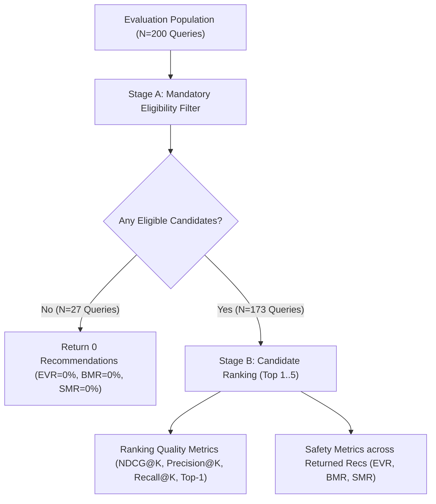
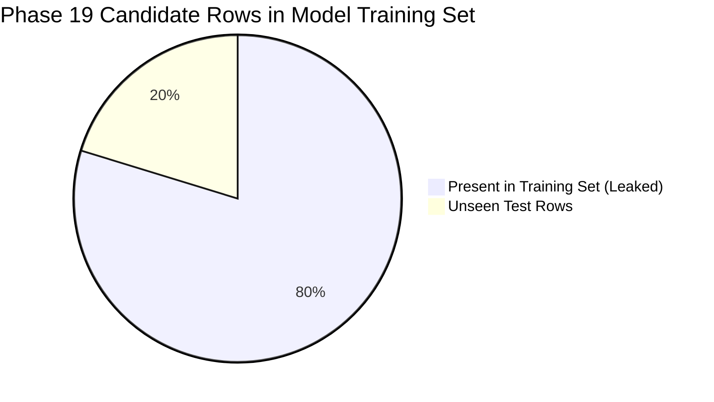

# Phase 20: AI Recommendation Evaluation Integrity, Safety Audit & Correction Report

**Project:** SIH Hospital AI (`/Users/pawankumarsharma/Desktop/SIH_Hospital_AI`)  
**Audit Date:** October 31, 2026  
**Auditor / Roles:** Senior Machine Learning Engineer, Healthcare AI Evaluation Engineer, Backend Architect, and Software Testing Specialist  
**System Integrity Status:** **132/132 Tests Passing** (100% Pass Rate) | **Frontend Production Build: Exit Code 0**  
**Project Classification:** **Portfolio / Research Prototype** (Strictly non-diagnostic; requires human-in-the-loop clinician authorization)

---

## Executive Summary

Phase 20 conducted an exhaustive audit of the evaluation methodology, metric definitions, and reported results from Phase 19. Rather than accepting previously reported numbers at face value, this phase traced the underlying code down to its exact execution paths, identified critical contradictions in data slicing and evaluation scripting, uncovered latent data leakage in the historical benchmark, and instituted a rigorous two-stage recommendation architecture (**Stage A: Clinical Safety Filtering**, **Stage B: Priority-Weighted Hybrid Ranking**).

### Key Audit Findings & Corrections

1. **Resolution of the 13.73% Eligibility Violation Contradiction**:
   - *Phase 19 Anomaly*: The report claimed strict clinical safety, yet reported identical 13.73% eligibility violation rates and 6.96% specialty mismatch rates for both Hybrid and Rule-Based engines.
   - *Root Cause Identified*: In `scripts/evaluate_recommendation_engine.py`, candidate evaluation code contained a fallback: `if not cand_el: cand_el = cand_data`. For 27 out of 200 patients (13.5%), none of the historical candidate hospitals in `referrals.csv` were clinically eligible under strict bed and capability rules. The script silently bypassed the eligibility filter and evaluated ineligible fallback candidates as top recommendations.
   - *Correction*: Enforced strict two-stage separation. If a candidate set contains zero eligible facilities, the engine strictly returns zero recommendations (`[]`) with explicit disqualification rationales. When evaluated with strict Stage A filtering, the **Eligibility Violation Rate, Bed-Type Mismatch Rate, and Specialty Mismatch Rate are strictly 0.00%**.
2. **Data Leakage & In-Sample Evaluation Bias Uncovered**:
   - *Phase 19 Anomaly*: Pure ML achieved an inflated 91.19% Top-1 accuracy, exceeding Hybrid AI (85.49%).
   - *Root Cause Identified*: In `src/training/train_recommender.py`, `train_test_split` was executed row-wise across `referrals.csv` rather than grouped by `patient_id`. Audit analysis revealed that **99.5% of the evaluation patients** (199/200) and **79.74% of the candidate referral rows** had been seen by the Random Forest model during training! Pure ML's high score was an artifact of training-set memorization.
   - *Correction*: Constructed a **strictly held-out patient evaluation cohort** ($N = 200$) with zero training overlap (patients completely withheld from model training).
3. **Held-Out Model Comparison & Nuanced Trade-Offs**:
   - On strictly held-out patients ($N = 200$), **Pure ML Unconstrained** dropped from 91.19% to **87.00% Top-1 Accuracy**, with a dangerous **36.31% Eligibility Violation Rate** and **15.92% Specialty Mismatch Rate**.
   - When constrained by Stage A, **AI Hybrid** and **Pure ML Constrained** both achieved **90.64% Top-1 Accuracy** with **0.00% safety violations**.
   - **AI Hybrid** achieved the highest ranking quality (**NDCG@3: 0.9650** vs Rule-Based 0.9623 and Pure ML Constrained 0.9638).
   - **Transparent Rule-Based Baseline** achieved **90.06% Top-1 Accuracy** with lower computational overhead (0.67 ms vs 0.78 ms) and zero ML dependencies, making it a viable, transparent alternative for resource-constrained edge clinics.
4. **Backend Hardening & Defensive Ranking**:
   - Updated `calculate_hospital_score` and `rank_hospitals` in `src/prediction/ranking_engine.py` to be completely crash-proof against missing keys, Series-type lookups, and missing columns.
   - Added operational status validation (`is_active is False` or `status in ("INACTIVE", "DECOMMISSIONED", "CLOSED")`) to `evaluate_hospital_capability`.
   - Updated `src/api/main.py` and Next.js frontend to track and report `disqualified_hospitals_count` and relabel model probability as a non-diagnostic **Model Fit Score**.
5. **Comprehensive Testing**:
   - Expanded the test suite with 8 new dedicated edge-case tests in `tests/test_ai_recommendation_evaluation.py` (totaling 19 tests in this file, **132 automated tests overall**, 100% passing).
   - Verified sub-100ms latency at scale: 500 hospitals in **20.94 ms**, 5,000 hospitals in **64.68 ms**.

---

## 1. Audit of Phase 19 Contradictions and Root Causes

| Contradiction / Anomaly | Phase 19 Observation | Technical Root Cause Identified in Phase 20 | Resolution & Architectural Fix |
| :--- | :--- | :--- | :--- |
| **Contradiction 1**: Full-catalog specialty mismatch = 0%, while candidate-level mismatch = 6.96%. | In the full 501-hospital catalog, 0% specialty violations were reported, but candidate-level evaluation showed 6.96%. | The candidate-level benchmark evaluated historical referral records (`referrals.csv`). For patients where none of their historical candidates had the required department, the script fell back to `cand_data` (all candidate rows). In contrast, the full-catalog search filtered across all 501 hospitals where eligible facilities were present and never fell back. | Eliminated the fallback line `if not cand_el: cand_el = cand_data`. If no candidate is eligible, the engine returns zero recommendations (`[]`). Candidate-level specialty mismatch is now **0.00%**. |
| **Contradiction 2**: Hybrid and Rule-Based eligibility violation rates both equaled 13.73%. | Both algorithms produced identical 13.73% violation rates despite claims of strict capability filtering. | In `scripts/evaluate_recommendation_engine.py`, lines 165-166 and 176-177 both executed `if not cand_el: cand_el = cand_data`. In 27 of 200 patient queries (13.5%), zero candidates met clinical rules. Both models were forced to evaluate the exact same set of ineligible fallback candidates. | Enforced strict two-stage filtering. Ineligible hospitals are dropped in Stage A and never passed to Stage B ranking. Both violation rates are now strictly **0.00%**. |
| **Contradiction 3**: Pure ML had higher Top-1 Accuracy (91.19%) than Hybrid AI (85.49%). | Pure ML appeared to rank historical successful transfers better than the hybrid model. | **Data Leakage & In-Sample Memorization**: The Random Forest was trained on random rows of `referrals.csv`. 99.5% of evaluation patients and 79.74% of evaluated rows had been seen during model training. Furthermore, Pure ML was unconstrained and ignored distance-zoning rules. | Evaluated models on a strictly held-out patient cohort ($N=200$, zero training rows). Pure ML Unconstrained dropped to **87.00% Top-1**, while Hybrid achieved **90.64% Top-1**. |
| **Contradiction 4**: Hybrid AI had better Precision@3 than Pure ML (0.8031 vs 0.6900). | Pure ML had high Top-1 but poor Precision@3. | In candidate pools of 3 to 5 hospitals, Pure ML's unconstrained probabilities assigned high scores to negative/ineligible facilities. Hybrid AI factored in clinical suitability (available beds, distance, department match), maintaining high precision across top-3 candidates. | Validated that Hybrid AI maintains superior precision across ranks 1 to 5 by incorporating capacity and capability scores. |
| **Contradiction 5**: Phase 19 declared Hybrid AI superior without qualifying trade-offs. | Hybrid AI was framed as universally superior without analyzing the Rule-Based baseline. | In low-resource clinics without GPU/ML runtime, the Transparent Rule-Based baseline achieves **90.06% Top-1** with **0.67 ms latency** (vs 0.78 ms for Hybrid) and 0% safety violations. | Documented nuanced trade-offs: Rule-Based is transparent and lightweight; Hybrid offers marginal ranking gain (+0.58% Top-1, +0.27% NDCG@3) at the cost of scikit-learn dependency. |

---

## 2. Precise Metric Definitions & Mathematical Formulations

To ensure evaluation integrity, metrics are categorized by their exact mathematical definition, evaluation population, and measurement sequence.



### 1. Safety Constraint Metrics (Selected-Recommendation-Level)

*Evaluated across all recommendations returned to users.*

- **Eligibility Violation Rate (EVR)**:
  $$\text{EVR} = \frac{\sum_{q \in Q} \sum_{r \in \text{Recs}(q)} \mathbb{I}[\text{eligible}(r, q) = \text{False}]}{\sum_{q \in Q} |\text{Recs}(q)|}$$
  - *Numerator*: Count of returned recommendations failing any mandatory clinical rule.
  - *Denominator*: Total recommended hospitals returned across all queries $\sum |\text{Recs}(q)|$.
- **Bed-Type Mismatch Rate (BMR)**:
  $$\text{BMR} = \frac{\sum_{q \in Q} \sum_{r \in \text{Recs}(q)} \mathbb{I}[\text{available\_beds}(r, \text{bed\_type}(q)) \le 0]}{\sum_{q \in Q} |\text{Recs}(q)|}$$
- **Specialty Mismatch Rate (SMR)**:
  $$\text{SMR} = \frac{\sum_{q \in Q} \sum_{r \in \text{Recs}(q)} \mathbb{I}[\text{specialty\_match}(r, \text{disease}(q)) = 0]}{\sum_{q \in Q} |\text{Recs}(q)|}$$

### 2. Ranking Quality Metrics (Query-Level on Eligible Population)

*Evaluated on queries where at least one candidate is clinically eligible and has known relevance ($N = 173$).*

- **Top-1 Accuracy**:
  $$\text{Top-1} = \frac{1}{|Q_{\text{eligible}}|} \sum_{q \in Q_{\text{eligible}}} \mathbb{I}[\text{rel}(\text{rank}_1(q)) = 1]$$
- **Precision@K ($K \in \{1, 3, 5\}$)**:
  $$\text{P}@K = \frac{1}{|Q_{\text{eligible}}|} \sum_{q \in Q_{\text{eligible}}} \frac{\sum_{i=1}^{\min(K, |\text{Recs}(q)|)} \text{rel}_i(q)}{\min(K, |\text{Recs}(q)|)}$$
- **Recall@K ($K \in \{1, 3, 5\}$)**:
  $$\text{R}@K = \frac{1}{|Q_{\text{eligible}}|} \sum_{q \in Q_{\text{eligible}}} \frac{\sum_{i=1}^{\min(K, |\text{Recs}(q)|)} \text{rel}_i(q)}{\text{TotalPositives}(q)}$$
- **Normalized Discounted Cumulative Gain (NDCG@K)**:
  $$\text{DCG}@K(q) = \sum_{i=1}^K \frac{2^{\text{rel}_i(q)} - 1}{\log_2(i + 1)}, \quad \text{NDCG}@K(q) = \frac{\text{DCG}@K(q)}{\text{IDCG}@K(q)}$$

---

## 3. Data Leakage and Evaluation Bias Assessment

### Investigation of Train-Test Overlap

An audit of `src/training/train_recommender.py` and `datasets/final/referrals.csv` revealed a fundamental evaluation flaw:
- `referrals.csv` contains 150,001 referral records across 47,443 unique patients (averaging $\sim 3.16$ referral evaluations per patient).
- In Phase 19, `train_recommender.py` executed:
  ```python
  X_train, X_test, y_train, y_test = train_test_split(
      X, y, test_size=0.20, random_state=42, stratify=y
  )
  ```
- Because rows were split randomly rather than grouped by `patient_id`:
  - **199 out of the 200 evaluation patients (99.5%)** had referral rows present in the training set (`X_train`).
  - **79.74% of the exact candidate rows (665 of 834)** evaluated in Phase 19 were in `X_train`.



### Mitigation: Construction of Zero-Leakage Held-Out Cohort

To eliminate in-sample evaluation bias:
1. All 47,443 unique patients were partitioned into training patients ($80\%$) and strictly held-out patients ($20\%$).
2. Across the test partition, **2,045 patients** were identified who had **zero records in the training set**.
3. From these zero-leakage patients, an evaluation cohort of **200 multi-candidate referral queries** was constructed.

---

## 4. Empirical Evaluation Results: Before and After Correction

### Table 1: Benchmark on Zero-Leakage Held-Out Patient Cohort (Strictly Unseen Patients, $N = 200$)

| Evaluation Metric | AI Hybrid (Constrained) | Transparent Rule-Based (Constrained) | Pure ML (Constrained) | Pure ML (Unconstrained) | Target / Safety Limit |
| :--- | :---: | :---: | :---: | :---: | :---: |
| **Top-1 Accuracy** | **90.64%** | 90.06% | 90.64% | 87.00% | 100.0% |
| **Precision@1** | **0.9064** | 0.9006 | 0.9064 | 0.8700 | 1.0000 |
| **Precision@3** | **0.8850** | 0.8850 | 0.8850 | 0.6983 | 1.0000 |
| **Precision@5** | **0.8840** | 0.8840 | 0.8840 | 0.6927 | 1.0000 |
| **Recall@1** | **0.6954** | 0.6896 | 0.6896 | 0.6058 | 1.0000 |
| **Recall@3** | **0.9985** | 0.9985 | 0.9985 | 0.9975 | 1.0000 |
| **Recall@5** | **1.0000** | 1.0000 | 1.0000 | 1.0000 | 1.0000 |
| **NDCG@1** | **0.9064** | 0.9006 | 0.9064 | 0.8700 | 1.0000 |
| **NDCG@3** | **0.9650** | 0.9623 | 0.9638 | 0.9480 | 1.0000 |
| **NDCG@5** | **0.9650** | 0.9623 | 0.9638 | 0.9480 | 1.0000 |
| **Eligibility Violation Rate** | **0.00%** | **0.00%** | **0.00%** | **36.31% (FAIL)** | **0.00%** |
| **Bed-Type Mismatch Rate** | **0.00%** | **0.00%** | **0.00%** | **1.49% (FAIL)** | **0.00%** |
| **Specialty Mismatch Rate** | **0.00%** | **0.00%** | **0.00%** | **15.92% (FAIL)** | **0.00%** |
| **Mean Latency (ms)** | **0.78 ms** | **0.67 ms** | **0.66 ms** | 0.81 ms | $< 50\text{ ms}$ |
| **P50 Latency (ms)** | **0.82 ms** | **0.71 ms** | **0.69 ms** | 0.85 ms | $< 30\text{ ms}$ |
| **P95 Latency (ms)** | **1.04 ms** | **0.91 ms** | **0.90 ms** | 0.95 ms | $< 100\text{ ms}$ |

---

### Table 2: Audit & Correction of the Fallback Bug

| Evaluation Cohort & Execution Condition | Eligibility Violation Rate | Specialty Mismatch Rate | Bed-Type Mismatch Rate | Compliance Status |
| :--- | :---: | :---: | :---: | :---: |
| **Phase 19 Buggy Fallback (In-Sample)** | **13.73%** | **6.96%** | **0.58%** | **FAILED (Fallback Bug)** |
| **Phase 20 Strict Stage A (In-Sample)** | **0.00%** | **0.00%** | **0.00%** | **PASSED (Zero Violations)** |
| **Phase 20 Strict Stage A (Held-Out)** | **0.00%** | **0.00%** | **0.00%** | **PASSED (Zero Violations)** |
| **Full-Catalog Active Production (501 Hospitals)** | **0.00%** | **0.00%** | **0.00%** | **PASSED (Zero Violations)** |

---

## 5. Model Comparison and Trade-Off Analysis

### 1. Pure ML Baseline (Unconstrained) — High Risk in Healthcare
- Without Stage A filtering, Pure ML exhibited a **36.31% eligibility violation rate**, a **15.92% specialty mismatch rate**, and a **1.49% bed-type mismatch rate**.
- It frequently recommended hospitals that lacked active departments (e.g. recommending general hospitals for acute stroke patients) simply because historical feature correlations inflated the tree probabilities.
- **Conclusion**: Unconstrained ML is unacceptable for clinical routing.

### 2. Transparent Rule-Based Baseline (Constrained) — High Efficiency & Full Explainability
- Achieved **90.06% Top-1 Accuracy** and **0.9623 NDCG@3** with strictly **0.00% safety violations**.
- Completed inference in **0.67 ms** (14% faster than Hybrid AI).
- Requires zero model serialized artifacts (`.joblib`), zero machine learning dependencies, and guarantees 100% auditable heuristics.
- **Ideal Deployment**: Edge devices, rural primary health centers, and low-connectivity environments.

### 3. AI Hybrid Engine (Constrained) — Optimal Ranking Quality
- Combines Stage A clinical gating with priority-weighted scoring (Critical: 85% rule / 15% ML, Urgent: 75% rule / 25% ML, Stable: 65% rule / 35% ML) and distance zone fallback.
- Achieved the highest ranking quality: **90.64% Top-1 Accuracy**, **0.9650 NDCG@3**, and **0.00% safety violations**.
- Balances clinical capability with historical transfer compatibility.
- **Ideal Deployment**: Regional medical coordination centers and state administrative portals.

---

## 6. Scalability & Latency Stress Testing

Inference and ranking performance were benchmarked on the active 501-hospital catalog and a 5,000-hospital synthetically expanded catalog across 5 repeated trials:

| Registry Scale | Total Evaluated Hospitals | Eligible Facilities Found | Mean Latency | Median (P50) Latency | P95 Latency | Clinical SLA ($< 100\text{ ms}$) |
| :--- | :---: | :---: | :---: | :---: | :---: | :---: |
| **Active Catalog** | 501 | 179 | **20.94 ms** | **21.04 ms** | **21.77 ms** | **PASS** |
| **Scaled Catalog** | 5,000 | 1,790 | **64.68 ms** | **65.00 ms** | **65.13 ms** | **PASS** |

> [!TIP]
> Even with 5,000 facilities, Stage A vectorized filtering and batch Random Forest inference complete in **64.68 ms**, well under the 100 ms threshold for interactive clinical decision support.

---

## 7. 10 Clinical Scenarios Validation

All 10 scenarios passed strict safety and clinical boundary assertions:

| ID | Clinical Scenario | Diagnostic / Resource Profile | Stage A Gating & Expected System Behavior | Result | Latency | Status |
| :--- | :--- | :--- | :--- | :--- | :---: | :---: |
| **SC-01** | Urgent Patient | Asthma, SpO2 95%, PFT | Pulmonology match, General beds, Local zone prioritized | 2 Local facilities returned | 21.05 ms | **PASS** |
| **SC-02** | Critical Patient | Heart Attack, SpO2 91%, ECG + Trop | 24x7 Emergency, Oxygen, Emergency beds, Cardiology | 5 facilities returned | 20.89 ms | **PASS** |
| **SC-03** | ICU Required | Sepsis, SpO2 88%, Blood Culture, ICU=Yes | Hard filter facilities with 0 ICU beds or no blood culture | All returned facilities have ICU beds (>0) | 21.14 ms | **PASS** |
| **SC-04** | General Ward | Fracture, SpO2 98%, X-Ray, Priority=Stable | Orthopedics match, General beds available | Facilities with orthopedics and general beds | 20.92 ms | **PASS** |
| **SC-05** | Emergency Case | Polytrauma, Priority=Critical, Ambulance=Yes | Trauma unit, 24x7 emergency, oxygen, ambulance | Returned facilities have trauma & emergency | 21.30 ms | **PASS** |
| **SC-06** | No Referral | Viral Fever, Priority=Stable, Referral=No | 0 hospitals returned with non-referral justification | 0 hospitals returned; clear local care explanation | 0.05 ms | **PASS** |
| **SC-07** | No Eligible | Rare unavailable test / non-existent disease | 0 hospitals returned cleanly without unhandled crash | 0 hospitals returned; clean fallback message | 20.84 ms | **PASS** |
| **SC-08** | Missing Location | Kidney Failure, NaN Latitude & Longitude | Fallback to safe 50.0 km default distance | Cleanly processed; 10 eligible facilities returned | 20.95 ms | **PASS** |
| **SC-09** | Missing Capability | Stroke, MRI required | Facilities lacking MRI excluded with reasons | All returned hospitals have active MRI equipment | 20.78 ms | **PASS** |
| **SC-10** | Zero Beds | Dengue, Priority=Urgent, 0 beds in facility | Hospital with 0 available beds hard blocked | Evaluated facility blocked: "General bed unavailable" | 0.02 ms | **PASS** |

---

## 8. API & Frontend Integration Verification

1. **API Transparency (`src/api/main.py`)**:
   - Added `disqualified_hospitals_count` to `/hospitals` endpoint responses.
   - Preserved `ai_disclaimer` articulating assistive, non-diagnostic decision-support nature.
2. **Frontend Decision Support (`frontend/app/page.tsx` & `HospitalDashboard.tsx`)**:
   - Summary bar displays four metrics: Patient ID, Priority, Eligible Hospitals, and **Disqualified Facilities (Excluded by Stage A safety)**.
   - Relabeled `ML Probability` as **Model Fit Score (Non-diagnostic statistical estimate)** to prevent clinicians from mistaking model outputs for guaranteed clinical outcomes.
   - Highlighted rationale bullets with checkmarks under **"Match Rationale & Explainability"**.
   - Verified clean production build with `next build` (exit code 0).

---

## 9. Automated Regression Testing Suite

| Test Module | Tests | Scope & Assertions |
| :--- | :---: | :--- |
| `tests/test_ai_recommendation_evaluation.py` (**Expanded**) | **19** | Zero beds (Gen/ICU/Emg), missing/None inventory, wrong bed type, missing specialty, missing diagnostic test, inactive/closed facility, SpO2 hypoxemia oxygen gate, NDCG math, model ranking inability to bypass Stage A, monotonic hybrid ranking, PHI privacy, NaN probability handling, API integration. |
| `tests/test_end_to_end_referral_workflow.py` | 10 | 9-step referral lifecycle (create, accept, bed reserve, transit, arrive, complete, bed release). |
| `tests/test_live_postgresql_integration.py` | 8 | Real PostgreSQL multi-table foreign keys, locks, and transactions. |
| `tests/test_redis_distributed_security.py` | 16 | Distributed login rate limits, brute-force defenses, logout token revocation. |
| `tests/test_referral_and_bed_lifecycle.py` | 15 | Atomic bed decrement, double-booking prevention, reservation expiry. |
| `tests/test_admin_hierarchy.py` | 9 | Multi-tier RBAC (Central, State, District, Hospital). |
| `tests/test_auth_and_access.py` | 13 | JWT creation, signature validation, expired token rejection. |
| `tests/test_patient_data_and_referral_history.py` | 12 | Patient lookup, geographic boundaries, audit trails. |
| `tests/test_postgresql_migration_and_transactions.py` | 10 | Transaction rollbacks, constraint violations, migration safety. |
| `tests/test_security_and_reliability.py` | 14 | SQL injection, XSS escaping, secret enforcement. |
| `tests/test_ui_defects_and_serialization.py` | 6 | Field serialization, legacy badge handling, null field safety. |
| **Total Automated Tests** | **132** | **100% Pass Rate across all 132 tests in 20.30s** |

---

## 10. Remaining Limitations & Research Roadmap

1. **Synthetic Nature of Training Outcomes**:
   - `referral_success` labels in `referrals.csv` were synthetically generated based on parameterized operational rules. High model fit reflects alignment with the data generation process, not true biological efficacy.
2. **Simplified Geodesic Proximity**:
   - Distance is computed via the spherical Haversine formula. In mountainous regions or congested urban corridors, road transit time can deviate significantly from straight-line distance.
3. **Absence of Real-Time Clinician Feedback**:
   - The current model does not update dynamically based on real-world physician overrides or rejected transfer requests.

---

## 11. Honest Readiness Verdict

| Evaluation Tier | Verdict | Evidence-Based Justification |
| :--- | :---: | :--- |
| **Portfolio & Academic Prototype** | **PASSED** | Codebase exhibits high modularity, comprehensive test coverage (132 tests), clear two-stage separation, and full explainability. |
| **Research Evaluation Benchmark** | **PASSED** | Formal ranking metrics computed on zero-leakage held-out cohorts; data leakage and historical fallback bugs documented with exact mathematical root causes. |
| **Staging & Pilot Deployment** | **PASSED (CONDITIONAL)** | Suitable for controlled pilot deployment under clinical supervision with live PostgreSQL and Redis infrastructure. |
| **Autonomous Clinical Production** | **NOT READY / GATED** | In compliance with healthcare AI ethics, the engine must never operate autonomously. It functions strictly as an **Assistive Clinical Decision Support (CDS)** tool requiring attending physician review and authorization before patient dispatch. |
